# CRR Working Manuscript — Sections 1–13

**Working title:** *Persistent particle-like structures, autonomous kinematics, and no established operational mass-energy in an engineered hypergraph rewriting system*

**Status:** P9 rebuttal-incorporated working draft; P8 text review and second-AI rebuttal resolved, figure set consolidated to eleven main-text figures, and the existing claim firewall preserved.

---

## 1. Abstract

Persistent localized structures are a familiar possibility in discrete dynamical systems, and hypergraph-rewrite models have proposed particle-like structures together with mass- and energy-like interpretations of recurrence and causal activity. Here we ask a narrower operational question: **how far can those ideas be made concrete and falsifiable in an explicit recurrent rewrite architecture?** The computational program spans three broad rule lineages together with a historically important transport-development bridge from an earlier Stage-W carrier branch into the later engineered FBCL/Y33 law. In the canonical binary example rule, the tested fixed-support recurrent architecture is fragile under ordinary background contact and fails exact repair in the complete 142-branch destructive-case census. An exhaustive search of a later 77,314-rule ternary family finds 80 rules with closed nontrivial full-turnover recurrent classes. A subsequent co-designed FBCL/Y33 carrier law supports an exact elementary recurrent carrier, seven tested bonded composites, finite local bond dynamics, relabel-covariant rest and moving recurrence, and environmentally triggered transitions among autonomously maintained kinematic sectors. These positive recurrence and kinematic results do not produce an operational mass-energy observable. The surviving curvature proxy is exactly topology-blind; the tested linear state-conservation search collapses to constituent-number quantities; a topology-sensitive closed-path action correspondence is later reinterpreted as environmental relay-incidence dressing rather than producer-owned bond turnover; and no independent safe rest-local exchange channel has been demonstrated. A minimal existing-grammar rival destroys the unique next rest recurrence, while a two-carrier response is reduced by stronger controls to preparation-procedure-dependent formation memory. The working carrier grammar is an engineered existence construction with sequential event selection and is not shown to be causally invariant. We therefore find that persistent particle-like kinematics can be engineered and measured in this relational rewrite system while operational rest energy and independently calibrated inertial mass remain undefined. The contribution is a rule-specific, falsification-oriented measurement program, not a claim of physical particle identification or a fundamental rule of nature.

## 2. Introduction

### 2.1 From persistent computation to physical observables

Discrete local dynamical systems can support long-lived localized structures. Cellular automata contain gliders and soliton-like localizations; nonlinear lattices support discrete breathers; graph-rewriting systems can generate persistent organized structures. In the Wolfram Physics Project, the state of space is represented relationally and updated by local replacement rules, with particle-like behavior proposed to arise from persistent local structure rather than from primitive particle labels [Wolfram2020; GorardQM2020]. Related Wolfram-model work places causal invariance at the center of the route from microscopic rewriting to covariance and relativistic behavior [GorardRel2020; GorardCausalSets2020].

Those precedents establish that recurrence and localization are reasonable ingredients to investigate. They do not by themselves answer a more operational question: when a concrete rewrite system contains an object that repeatedly reconstructs itself, moves, rests, binds to copies of itself, and responds to its environment, **what additional evidence is required before model-internal activity can be called energy or inertial mass?**

That distinction motivates the present study. A recurrent object can possess many scalar descriptors: event counts, relation turnover, recurrence frequency, local causal flux, environmental dressing, or edit cost. Some may be reproducible and species-dependent. But reproducibility alone does not make a scalar an energy. Likewise, a motion-dependent cost or curvature proxy is not automatically inertial mass. In this work, an operational mass-energy interpretation is withheld unless a candidate can participate in an independently defined local exchange process and be compared against an independently calibrated response of the carrier. This requirement is deliberately stronger than identifying a quantity that merely scales with recurrence.

The investigation consequently treats three questions separately:

1. Can persistent recurrent localized structures exist in the tested rewrite architectures?
2. Can their rest and moving recurrence be generated from current relational state rather than from an externally prescribed trajectory?
3. Does the resulting system possess an independently exchangeable and conserved quantity that supports an operational relation between rest content and inertial response?

The first two questions receive strong positive answers within the final engineered carrier architecture. The third does not.

### 2.2 Relation to prior hypergraph and discrete-localization work

The broad concepts investigated here are not presented as new. Wolfram's hypergraph-rewrite program already proposes persistent localized structures as particle analogues and discusses possible translations of node reuse and causal-edge flux into mass- and energy-like language [Wolfram2020; WPP-Translations]. Gorard develops particle-like excitations and formal causal-invariance machinery in the Wolfram-model setting [GorardQM2020; GorardRel2020]. Outside that literature, gliders and particle-like localizations are well developed in cellular automata [Martinez2012], and localized recurrence has a long mathematical history in discrete-breather systems [FlachGorbach2008].

The contribution claimed here is therefore narrower. We follow explicit microscopic rewrite architectures through a long sequence of **rule-specific computational measurements and attempted falsifications**: survival under an evolving environment, exact repairability, exhaustive recurrent-rule search, composite formation, local bond dynamics, relabel covariance, autonomous sector selection, environmental interventions, conservation tests, local coupling eligibility, and scaffold-removal controls. A targeted literature review did not reveal a close published counterpart to this complete measurement chain. That observation is used only for positioning; it is not treated as a proof of priority.

The present study also differs from the causal-invariance program in an important respect. The final CRR carrier engine is relabel-covariant on its tested manifold, but the complete rewrite system is **not shown to be causally invariant**. Event ordering matters, a global sequential scheduler remains part of the apparatus, and later multi-carrier survival requires an explicit recurrence-obligation scheduling rule. Accordingly, none of the results below is interpreted as a derivation of Lorentz invariance, foliation independence, or relativistic particle dynamics.

### 2.3 Three broad rule lineages and a historically important transport-development bridge

The investigation spans three broad rule lineages rather than one progressively repaired rule. Within the ternary program, however, a separate Rule-55584 carrier branch became the starting point for a long transport-development sequence that ultimately produced a different co-designed law. That bridge is historically important and is stated explicitly below so that results from Rule 55744, Rule 55584, and FBCL/Y33 are not conflated.

The first lineage is the canonical binary Wolfram-style example rule. It was used to test whether a compact recurrent translating structure could survive ordinary background activity through internal repair. In the tested fixed-support architecture, exact return after destructive contact fails throughout the complete 142-branch fixed-size predictive-quotient repair census. Structural analyses then locate obstructions involving relation-floor monotonicity, causal direction, frontier adjacency, and zero-incidence states. These are strong negative results for that architecture, but not a theorem that the canonical rule can support no conceivable particle encoding.

The second lineage is the Stage-W ternary closure family. A frozen structurally branching eight-output family contains 77,314 resolved rules; 80 contain at least one closed nontrivial full-constituent-turnover recurrent strongly connected class. Rule 55744 is selected as the strongest environmental-survival case in that search. Rule 55584 is a different Stage-W closure hit and later supplied the recurrent carrier population used in the Y1–Y6 recurrence-energy and subsequent transport investigations. Thus 55744 and 55584 are distinct rules within the same broader searched family, not alternate names for one rule.

The historical bridge begins from the Rule-55584 carrier branch but does not remain on the Rule-55584 dynamics. Through the X-series and early Y-series, transport, reversal, rest, and flux-balance mechanisms were progressively co-designed. By Y47 the successful carrier architecture used the Y33/Y46/Y47 dynamics. Y48 tested whether that architecture was merely a portable wrapper around the original twelve Rule-55584 identities: 0/576 transfer trajectories survived the first event, and the Y33-best/Y47 output grammar shared 0/8 relations with Rule 55584. The positive Y47 curvature therefore belongs to the later co-designed law, not to the original Rule-55584 population. Y50 then explicitly named the successful Y33/Y46/Y47 construction **FBCL, the Flux-Balanced Carrier Law**.

The third broad lineage is consequently the mature FBCL/Y33 program, a continuation of that Y33/Y46/Y47 co-designed law rather than a fourth independent grammar. It produces the DS001 elementary carrier and a family of R5/R6 bonded composites. Later stages rebuild the carrier engine around graph-defined causal roles, remove identifier dependence on the tested manifold, and expose environmental channels that can switch carriers among autonomous kinematic sectors. The later mass-energy and two-particle programs are conducted on this FBCL/Y33 lineage, with additional scheduler or intervention rules stated explicitly when introduced.

Keeping these distinctions separate prevents the paper from implying that later successes repaired the canonical rule, that Rule 55744 and Rule 55584 are the same Stage-W rule, or that Y47 and FBCL/Y33 are different dynamics.

### 2.4 A recurrent population with local composite mechanics

The FBCL/Y33 program eventually yields eight same-law complete-manifold identities: DS001 and seven bonded composites. These structures support tested rest and signed moving sectors and remain identifiable under a common carrier grammar. Their composite behavior also becomes substantially simpler than the historical construction path suggests.

At the bond level, the mature R5/R6 dynamics reduce to a finite causal-role transducer built from literal rewrite roles. Four role-resolved microstates are sufficient on the tested manifold, with a three-state constitutive quotient and one local update-order bit closing the remaining boundary transients. Independent geometric analysis gives a renewable coordination bound of two neighbors per constituent within the tested contact shell. Mature bond recurrence also sheds its constitutive formation history: after convergence, different valid formation paths obey the same local future law, and deleting the identified compact formation fossil leaves that mature recurrence unchanged.

These results are reported as properties of a finite tested manifold. The particles are **inserted by prescribed procedures**; native nucleation of the FBCL/Y33 carrier population from generic vacuum evolution has not been established.

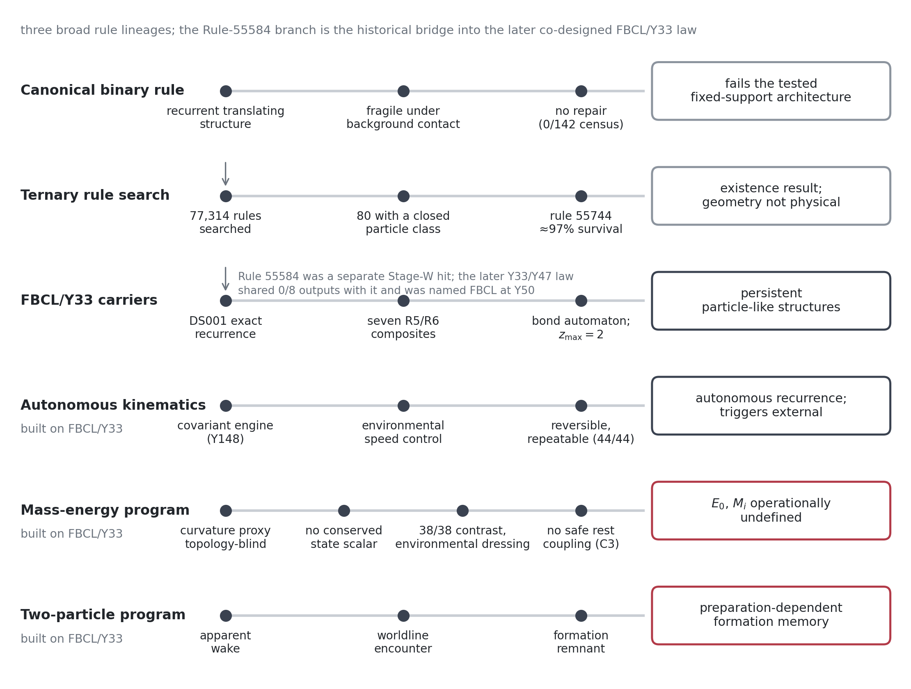

**Figure 1.** Three broad rule lineages are shown: the canonical binary rule, the Stage-W ternary family, and the later co-designed FBCL/Y33 law. Rule 55584 is a separate Stage-W closure hit within the ternary family and supplied the earlier recurrent-carrier branch; the X/early-Y development ultimately produced the distinct Y33/Y46/Y47 dynamics, which Y50 explicitly named FBCL. Y48 showed that the Y33/Y47 grammar shares 0/8 outputs with Rule 55584, so the bridge is historical rather than same-law. The mature FBCL/Y33 lineage then supports the autonomous-kinematics, mass-energy, and two-particle programs.

### 2.5 Autonomous kinematics and environmental control

A central methodological goal was to distinguish an object that merely follows an experimenter's motion script from one whose next recurrence is selected by its own relational state. The Y136–Y148 architectural rebuild replaces numeric labels, external phase counters, scripted successor arithmetic, and cleanup lookup tables with graph-local and causal-ancestry structures. Arbitrary relabeling tests expose and then remove several hidden representation dependencies. The resulting carrier engine reproduces the tested rest/motion recurrence autonomously on the frozen manifold.

The environment can then alter which graph-defined speed sector the carrier occupies without directly assigning a velocity. Deleting a specific sector-defining environmental relation causes a native transition from the slower to the faster moving sector after a finite internal transient; a separately defined occupancy-guarded source operation reverses the transition. The full five-constituent population executes the prescribed four-leg `v1→v2→v1→v2→v1` sequence in 44/44 registered cases, while untouched matched controls remain in the original sector. A settled period-two intermediate `|v|=3/2` orbit is also observed.

These experiments establish **environmentally triggered sector switching followed by autonomous recurrence**. They do not establish a spontaneous force. The trigger is externally applied, and the global scheduler remains part of the experimental apparatus.

### 2.6 Why the mass-energy program does not close

The main scientific tension of the project appears only after the recurrent and kinematic architecture becomes sufficiently stable to support meaningful cross-checks.

An early inertial-curvature proxy,

\[
M_{\rm curv}=N\,\frac{5}{8}\ln 2,
\]

is exactly extensive and topology-blind: composites with the same constituent count have zero binding residual under this observable. Several independently constructed rest-content or environmental quantities are topology-sensitive. The mismatch survives the later autonomous-engine rebuild, so it is not simply an artifact of the earlier scripted kinematics.

A broad conservation search likewise fails to find a nontrivial linear state-defined recurrence scalar in the tested structural basis. The surviving exact balances reduce to constituent-number quantities. Later transition experiments produce an exact and initially striking result: after one calibration, a same-N topology-contrast relation holds in 38/38 comparisons between an admissible transition-action quantity and an independently built rest/environmental quantity. But the total-value equivalence test fails. More importantly, a stricter producer-owned decomposition subsequently shows that the supposed bond action is zero for both R5 and R6 in the tested dimers; the topology-sensitive signal comes from persistent environmental relations migrating through the current bond-incidence sector. The numerical correspondence survives, but its interpretation changes from intrinsic bond turnover to environmental dressing.

The decisive operational problem is the absence of a safe independent rest-local coupling. Under the frozen original dynamics, the stationary carrier's next recurrence gate is unique and no separate native near-halo gate qualifies as an external action channel. A minimal extension that fires the one existing syntactic rival does not provide a gentle probe: the rival shares most of the native gate's causal support, consumes it, and immediately destroys the unique rest-role representation. The experiment therefore cannot define an exchanged rest quantity first and then measure an inertial response independently.

For that reason, this paper does not identify recurrence activity, environmental dressing, or the Y81 curvature proxy with physical mass-energy. Within the tested original CRR coupling architecture,

\[
E_0,\qquad M_i^{\rm independent},\qquad \alpha\text{ in }M_i=\alpha E_0
\]

remain operationally undefined. This is not a statement that the carriers have zero energy or zero mass, nor is it a theorem excluding every possible future extension.

### 2.7 Two-particle tests as a control on interpretation

The later two-carrier branch provides a useful example of why this conservative standard matters. A reproducible trailing-carrier response initially resembles a wake or delayed partner interaction. Successively stronger controls rule out the current remote leader, the compact formation fossil, several boundary differences, and simple scheduler-RNG explanations. Prospective mapping then shows that the receiver changes recurrence when its own worldline enters a pre-existing source-slot condition near the leader's old formation region.

On one fresh population, that map predicts 72/72 native onsets, and local source-slot normalization abolishes the response at all 24 registered anchors. A still later holdout shows that the detailed remnant pattern is not preparation-method invariant: two legitimate preparation procedures can produce an exactly matched mature leader while leaving different receiver-relevant environmental remnants in close geometries. The final classification is therefore **preparation-procedure-dependent formation memory**, not a preparation-independent particle-particle exchange field.

This sequence is representative of the paper's broader methodology. A positive effect is not promoted at its first successful description; the most plausible apparatus-based explanation is targeted by a stronger control whenever possible.

### 2.8 Contributions and scope of this paper

The paper makes five main contributions.

First, it gives rule-specific positive and negative results for persistent recurrence: a sharply fragile fixed-support architecture under the canonical example rule, an exhaustive finite ternary closure search, and a separate engineered grammar that supports an exact recurrent carrier population.

Second, it reduces the composite carrier dynamics to local causal-role structure, including a finite bond transducer and a finite renewable-coordination bound.

Third, it demonstrates a relabel-covariant autonomous carrier engine and repeatable environment-controlled transitions among graph-defined kinematic sectors, while explicitly separating that result from causal invariance of the complete rewrite system.

Fourth, it reports a sequence of candidate mass-energy observables, conservation tests, cross-observable correspondences, and local-coupling searches that culminate in a bounded negative conclusion: **operational rest energy and independently calibrated inertial mass are not established in the tested architecture**.

Fifth, it documents the scaffolding-removal methodology that repeatedly changed the interpretation of otherwise exact computational results. Numerical labels, event-order races, preparation histories, observer definitions, global scheduling, and ownership conventions are treated as potential experimental apparatus rather than silently absorbed into the physics.

The paper does **not** claim that the studied carriers are physical particles; that the rule is a model of nature; that natural carrier formation has been achieved; that the system is causally invariant or relativistic; that rest energy or inertial mass is zero; or that the observed formation-memory response is gravity or a generic interparticle force.

The remainder of the paper first positions the work relative to hypergraph-rewrite and discrete-localization literature (Section 3), then defines the four architectural phases and experimental methodology (Sections 4–5). Sections 6–9 present the recurrent-carrier, kinematic, mass-energy, and two-particle results. Section 10 audits experimental scaffolding and reinterpretations. Sections 11–13 state the claim firewall, bounded open problems, and reproducibility/AI-assisted workflow.

### References cited in Sections 1–2

- **[Wolfram2020]** S. Wolfram, “A Class of Models with the Potential to Represent Fundamental Physics,” *Complex Systems* 29(2), 107–536 (2020). DOI: 10.25088/ComplexSystems.29.2.107.
- **[GorardQM2020]** J. Gorard, “Some Quantum Mechanical Properties of the Wolfram Model,” *Complex Systems* 29(2), 537–598 (2020). DOI: 10.25088/ComplexSystems.29.2.537.
- **[GorardRel2020]** J. Gorard, “Some Relativistic and Gravitational Properties of the Wolfram Model,” *Complex Systems* 29(2), 599–654 (2020). DOI: 10.25088/ComplexSystems.29.2.599.
- **[GorardCausalSets2020]** J. Gorard, “Algorithmic Causal Sets and the Wolfram Model,” arXiv:2011.12174 (2020).
- **[Martinez2012]** G. J. Martínez, A. Adamatzky, F. Chen, L. Chua, “On Soliton Collisions between Localizations in Complex Elementary Cellular Automata: Rules 54 and 110 and Beyond,” *Complex Systems* 21(2), 117–142. DOI: 10.25088/ComplexSystems.21.2.117.
- **[FlachGorbach2008]** S. Flach, A. V. Gorbach, “Discrete breathers — Advances in theory and applications,” *Physics Reports* 467, 1–116 (2008). DOI: 10.1016/j.physrep.2008.05.002.
- **[WPP-Translations]** Wolfram Physics Project Technical Background, sections “Potential Basic Translations,” “Matter, Energy and Gravitation,” and “Elementary Particles.”

---

## 3. Relation to prior work

### 3.1 Wolfram-model context

This work studies local hypergraph rewriting as a substrate for recurrent localized structure. Its broad setting follows the class of relational rewrite models developed in the Wolfram Physics Project, where the instantaneous state is a graph or hypergraph, dynamics are generated by local replacement rules, and familiar spatial or physical concepts are sought as emergent properties rather than primitive inputs [Wolfram2020].

The idea that particles could correspond to persistent localized structures is also prior to the present work. The Wolfram Physics Project explicitly describes elementary particles as locally stable configurations of the hypergraph, and gives planarity-preserving graph rules as an illustrative mechanism by which local non-planar structures can be protected. Gorard subsequently formalized this type of construction using graph-minor obstructions and related it to combinatorial conservation arguments [GorardQM2020]. More generally, moving localized structures have long been studied in cellular automata as gliders or soliton-like localizations [Martinez2012], and time-periodic localized excitations are well established in nonlinear discrete lattices as discrete breathers or intrinsic localized modes [FlachGorbach2008]. The existence of localized recurrent computation is therefore not itself the novelty claimed here.

The present study asks a narrower operational question: starting from explicit rewrite rules, can one obtain a sufficiently well-characterized recurrent carrier population to measure persistence, composite structure, motion/rest recurrence, environmental response, and ultimately an independently testable mass-energy quantity without changing the definition of the object as the program proceeds?

### 3.2 Engineered rule search rather than a proposed fundamental rule

The CRR program is a separate computational investigation rather than a proposal for the microscopic rule of nature. It deliberately searches rule architectures for persistent recurrence and then subjects the successful constructions to increasingly restrictive controls. The final FBCL/Y33 carrier grammar is therefore an **engineered existence construction**. It demonstrates that a local relational rewrite architecture can support exact recurrent carriers, bonded composites and graph-defined kinematic sectors under the tested dynamics; it is not derived from known physics and is not claimed to be physically preferred.

This distinction matters when comparing the present work with the broader Wolfram-model program. Wolfram-model publications seek generic continuum or multiway consequences of classes of rewriting systems [Wolfram2020; GorardRel2020; GorardCausalSets2020]. CRR instead follows a small set of explicit microscopic architectures through detailed finite computational experiments, including failed architectures and scaffold-removal controls. The contribution is thus primarily rule-specific and experimental/computational.

### 3.3 Causal invariance is not assumed or established here

Causal invariance is central to the Wolfram-model route to reference-frame independence. In the standard formulation, different admissible update orders may generate different intermediate histories, but a causally invariant rule yields equivalent ultimate causal structure. Gorard shows that this property supports discrete analogues of general and Lorentz covariance [GorardRel2020], and related work connects it to causal-set constructions [GorardCausalSets2020].

The working CRR carrier system is **not shown to be causally invariant**. Event order can change outcomes, and later multi-particle work uses a global sequential event-selection mechanism; an explicit recurrence-obligation scheduler extension is required for qualified multi-particle coexistence. Accordingly, the results reported here concern persistence, recurrence, local causal roles and kinematics in a particular sequential rewriting architecture. They do not establish relativistic covariance, foliation independence, or locality of the complete update process.

Relabel covariance is treated separately. The Y142–Y148 carrier-engine program removes dependence on arbitrary vertex identifiers and external maintenance tables on the tested manifold. That is a representation/covariance result for the carrier law; it does not imply causal invariance of the global rewrite system.

### 3.4 Relation to proposed mass and energy translations

The Wolfram Physics Project already proposes abstract translations in which energy is associated with causal-edge flux, momentum with causal-edge flux through timelike hypersurfaces, and rest mass with local node reuse or repeated updating that does not continually recruit fresh nodes [Wolfram2020; WPP-Translations]. The present paper does not claim to originate those ideas and does not attempt to refute them generically.

Instead it asks what is required to instantiate an analogous interpretation **operationally in a concrete recurrent carrier architecture**. The program therefore distinguishes a model-internal activity or recurrence proxy from a physical-like energy observable unless the candidate can participate in an independently defined, local exchange process and be cross-checked against an independently calibrated inertial response. This additional operational requirement is the reason the paper can report persistent particle-like kinematics while still concluding that rest energy and independent inertial mass remain undefined in the tested CRR architecture.

### 3.5 Questions addressed in this paper

The study separates three questions that are often conflated in conceptual discussions:

1. **Can persistent recurrent localized structures exist in the tested rewrite architectures?**
2. **Can the rest/moving recurrence of a carrier be generated from current relational state rather than by an externally prescribed trajectory?**
3. **Does the resulting system possess an operationally conserved and exchangeable quantity that can be independently related to inertial response?**

The first two receive strong positive answers within the engineered FBCL/Y33 architecture. The third does not.

A targeted literature search did not locate a published program closely matching the complete chain of rule-specific repair analysis, exhaustive recurrent-rule search, recurrent composite census, structural kinematic reconstruction, causal scaffold removal, conservation tests and healthy rest-state exchange requirement used here. This absence should be read as a **positioning result, not a proof of priority**. Novelty claims in the manuscript are therefore confined to the specific computational findings and methodology reported for the tested rule families.

### References used in Section 3

- **[Wolfram2020]** S. Wolfram, “A Class of Models with the Potential to Represent Fundamental Physics,” *Complex Systems* 29(2), 107–536 (2020). DOI: 10.25088/ComplexSystems.29.2.107.
- **[GorardQM2020]** J. Gorard, “Some Quantum Mechanical Properties of the Wolfram Model,” *Complex Systems* 29(2), 537–598 (2020). DOI: 10.25088/ComplexSystems.29.2.537.
- **[GorardRel2020]** J. Gorard, “Some Relativistic and Gravitational Properties of the Wolfram Model,” *Complex Systems* 29(2), 599–654 (2020). DOI: 10.25088/ComplexSystems.29.2.599.
- **[GorardCausalSets2020]** J. Gorard, “Algorithmic Causal Sets and the Wolfram Model,” arXiv:2011.12174 (2020).
- **[Martinez2012]** G. J. Martínez, A. Adamatzky, F. Chen, L. Chua, “On Soliton Collisions between Localizations in Complex Elementary Cellular Automata: Rules 54 and 110 and Beyond,” *Complex Systems* 21(2), 117–142. DOI: 10.25088/ComplexSystems.21.2.117.
- **[FlachGorbach2008]** S. Flach, A. V. Gorbach, “Discrete breathers — Advances in theory and applications,” *Physics Reports* 467, 1–116 (2008). DOI: 10.1016/j.physrep.2008.05.002.
- **[WPP-Translations]** Wolfram Physics Project Technical Background, sections “Potential Basic Translations,” “Matter, Energy and Gravitation,” and “Elementary Particles.”

---

## 4. Substrate and rule lineage

The investigation did not use one rewrite rule or carrier architecture from beginning to end. Its scientific record is best described as three broad rule lineages with a distinct Rule-55584-to-FBCL transport-development bridge. This distinction is essential because later successes do not repair earlier failures by reinterpretation; they arise in different rules, in a co-designed successor law, or under explicitly stated event-selection extensions.

### 4.1 Canonical binary-rule program

The early program studied the canonical binary example rule

\[
(x,y),(x,z) \rightarrow (x,z),(x,w),(y,w),(z,w),
\]

with `w` fresh. Within the tested fixed-support recurrent architecture, localized translating/phase-bearing structures could be constructed, but ordinary background activity was destructive. Exact repair fails in the complete `0/142` destructive-branch census of the fixed-size predictive quotient. Structural analyses then identified relation-floor, causal-direction, adjacency, and zero-incidence obstructions that explain why the tested repair architectures fail.

These results should be framed narrowly. They show that **the tested fixed-support architecture is not a viable persistent-particle architecture under this rule**. They do not prove that no other encoding, support definition, scheduler, or recurrent object could ever persist under the canonical rule. The final manuscript should not use the stronger phrase “the canonical rule cannot support particles.”

The separately reported `1/3` destructive-branch fraction remains primary-artifact-pending and is therefore not used as a headline quantitative premise in this draft.

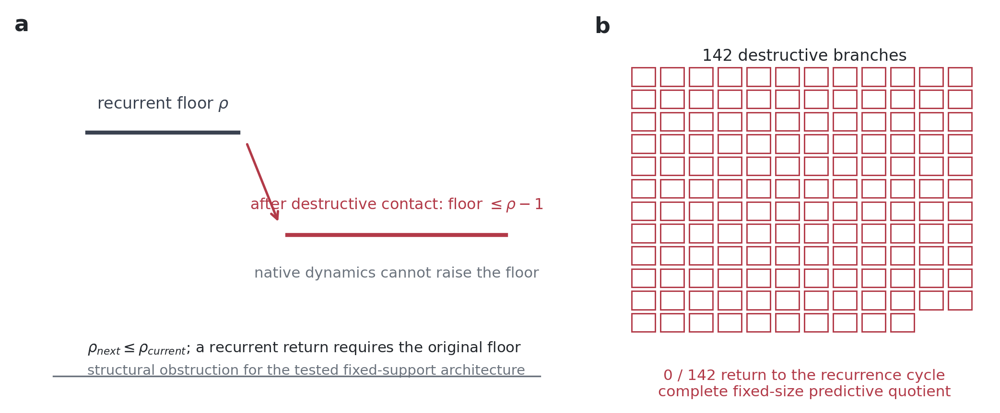

**Figure 2.** (a) Structural repair obstruction in the tested fixed-support architecture. The predictive-equivalence relation floor cannot increase under the native dynamics, while destructive contact lowers the attainable floor; exact recurrence would require restoring the original floor. (b) All 142 destructive branches were tested in the complete fixed-size predictive quotient, and none returned to the recurrence cycle. 

### 4.2 Ternary closure search and rule 55744

The next major branch expanded the local relation structure and searched explicitly for closed full-turnover recurrent producer classes. Stage W exhaustively resolved `77,314` rules in the frozen structurally branching eight-output family. `80` contained at least one closed nontrivial full-constituent-turnover particle strongly connected component: `66` of graph period 2 and `14` of graph period 3.

Rule `55744` was the strongest environmental-survival case in that family. Its producer-flow survival was measured at `96.71%` in the 2k screen, `96.920% ± 0.182%` across four 5k histories, and `96.828%` at 80k events. The 80k audit found `8,113` exact natural particle-support occurrences, although overlapping supports mean this number is not an independent particle count. The same candidate’s measured local ball-growth dimension is approximately `4.6`, so the rule is valuable as a computational existence result but does not provide a physical-like emergent spatial geometry.

This branch establishes a key methodological point: persistent particle-like producer classes are not absent from the searched rule space, but they are rare in the particular family tested. It does not identify a fundamental law.

### 4.3 Rule-55584 carrier branch and the transition to FBCL/Y33

Rule `55584` is one of the Stage-W closure hits and underlies the original Y1–Y6 recurrence-energy population. The subsequent X-series and early-Y program attempted to add momentum, transport, reversal, rest, and flux-balance structure. The important historical fact is that this development did **not** leave the Rule-55584 grammar unchanged.

By Y47 the successful transport/rest architecture used the Y33/Y46/Y47 co-designed dynamics and produced a positive finite curvature for its reference carrier. Y48 then tested whether this later architecture could be transferred, unmodified, to the twelve frozen Rule-55584 identities. It could not: across 576 carrier/spectator/site/sector trajectories, zero survived the first event, and an exhaustive first-event backup diagnostic found 0/64 identity-preserving gates. A direct grammar audit showed why the comparison is not same-law: the Y33-best/Y47 output grammar shares **0 of 8** output relations with Rule 55584.

This audit also resolves the earlier naming ambiguity. **Rule 55584 and Rule 55744 are distinct Stage-W rules.** Rule 55744 is the strongest environmental-survival case from the closure search; Rule 55584 supplied the earlier recurrent carrier branch. The later Y47 result belongs to neither of those unchanged rules.

At Y50 the successful Y33/Y46/Y47 construction was explicitly named **FBCL — the Flux-Balanced Carrier Law**. The name is new at Y50; the dynamics being named are the same co-designed carrier law already used in Y47.

### 4.4 Mature FBCL/Y33 carrier program

The mature carrier/composite program continues the Y33/Y46/Y47 law subsequently named FBCL. This is the architecture on which the paper’s DS001/composite, autonomous-kinematics, environmental-control, and later mass-energy measurements rest.

The grammar supports the recurrent monomer carrier DS001 and bonded R5/R6 composite structures. By Stage Y80 the frozen same-law complete-manifold population contained eight identities—DS001 plus seven composites—with tested recurrent `rest`, `+/-v1`, and `+/-v2` sectors. Later stages reduced the bond dynamics to a finite causal-role automaton, established a maximum renewable coordination of two in the tested contact shell, rebuilt the carrier/rest engine into a relabel-covariant structural form, and demonstrated environmental control of graph-defined speed sectors.

The FBCL/Y33 grammar was selected and co-designed because it supports the phenomena under study. This is an existence construction in rule space, not evidence that the grammar is physically preferred. Later model extensions—most importantly the D3-4 recurrence-obligation scheduler used for qualified multi-particle coexistence—are reported separately rather than folded silently into the base grammar.

### 4.5 Rule-lineage table

| Historical phase | Rewrite architecture | Principal paper role | Principal limitation |
|---|---|---|---|
| Early fragility/repair | Canonical binary example rule | Claim 1 | Tested fixed-support architecture fails; `0/142` repair census primary-verified; separate `1/3` fraction remains primary-pending |
| Closure-first ternary search | Stage-W structurally branching family; Rule 55744 is strongest environmental-survival case | Claim 2 | Rare existence result; emergent dimension ~4.6; not proposed as nature |
| Rule-55584 carrier branch → transport-development bridge | Begins with the original Rule-55584 recurrent population; culminates in the distinct Y33/Y46/Y47 co-designed law | Historical context for the transition into FBCL | Not one unchanged law: Y48 gives 0/576 transfer survival and 0/8 grammar overlap with Rule 55584 |
| Mature carrier/composite program | Y33/Y46/Y47 law, explicitly named FBCL at Y50, plus documented later scheduler extensions | Claims 3–14 | Engineered grammar; prescribed formation; sequential scheduler; no operational mass-energy |

The paper will not mix numerical results across these phases without stating the rule/architecture transfer explicitly.

## 5. Methods

### 5.1 Experimental philosophy

The investigation evolved into a falsification-oriented workflow because many early apparent effects disappeared under stronger controls. A result was progressively treated as credible only when its dependency on representation, scheduler, preparation, or experimental scaffold had been tested directly. The mature workflow therefore emphasizes prospective freezes, explicit denominators, exact provenance, matched controls, and post-verdict reinterpretation rather than one-shot simulation output.

The standing rule for this paper is:

> **An effect is not promoted as intrinsic until the experimental scaffold capable of producing it has been removed, randomized, surgically controlled, or shown causally irrelevant.**

This rule is methodological, not a property of the rewrite dynamics. Section 10 will document the main cases where applying it changed the scientific interpretation.

### 5.2 Frozen protocols and denominators

For mature stages, the protocol, candidate population, seeds, source code, relevant parent hashes, observables, and stop criteria were frozen before opening the scored outcome whenever technically possible. Registered cases remained in the denominator when they failed preparation or became prospectively unassessable; such cases were not silently dropped and replaced.

When an implementation error occurred before any scientific result was opened, the failed source/protocol artifact was preserved and a separately hashed administrative correction was made. When an error affected a scientific run, the relevant case was retained as failed or unassessed according to the frozen protocol rather than repaired post hoc. This distinction is visible in later Y164/Y165 checkpoint packages and is part of the claims ledger.

### 5.3 Development, validation, holdout, and forensic evidence

The paper distinguishes four evidence classes:

- **Development:** used to derive a candidate rule, classifier, or mechanism; never counted as independent validation.
- **Prospective validation / holdout:** candidate and gate frozen before opening the new population.
- **Post-verdict diagnostic:** used to understand a completed outcome; cannot retroactively strengthen the preregistered gate.
- **Retrospective forensic:** reads archived cases to identify a mechanism or artifact; useful for explanation but not an independent replication.

This distinction is especially important in the mass-energy and D37 programs, where later diagnostics often clarified the mechanism without changing the original pass/fail denominator.

### 5.4 Exact lineage and provenance recording

Stage Y96 introduced an instance-level lineage recorder that assigns producer and consumer identities to relation instances while remaining dynamically passive. Identical relation tuples deleted and later recreated receive distinct instance identities. Passivity was checked checkpoint-by-checkpoint across vacuum, moving-carrier, and stationary-rest regression corpora rather than only at endpoints.

This recorder became central to later causal claims. It allowed the program to distinguish a relation that is merely geometrically present from one that is causally descended from a carrier, preparation step, vacuum fire, or later consumer event. The D37 formation-memory classification and the Y165 producer-lifetime assays depend on this distinction.

### 5.5 Relabeling covariance tests

Numeric vertex labels are not physical observables. Whenever a selector or relay appeared to depend on coordinate arithmetic or label order, the program attempted to reconstruct it from relational roles, causal ancestry, and local graph structure, then tested it under arbitrary bijective relabelings.

Y142 provides the clearest example. The intrinsic carrier relay passed `11,520/11,520` arbitrary relabeling tests, while the older scalar formula reproduced the mapped relay in only `2/11,520`. Such negative controls are important: covariance was not inferred from canonical trajectories alone.

Relabel covariance is treated as a necessary representation check, but not as causal invariance of the full rewrite system.

### 5.6 Matched worlds and counterfactual controls

Many later experiments use cloned complete states to construct matched worlds differing by a single registered factor. Examples include untreated/intervention branches, pair/solo D37 worlds, passive/near/remote coupling arms, and scheduler-bypass receiver clamps. Clones preserve RNG, lineage, scheduler, and state unless the protocol explicitly defines the changed variable.

A comparison is interpreted causally only to the extent that the matched control removes plausible alternative explanations. D37R illustrates the limit: upstream surgery changed the response in `15/15` viable cases, but the strict matched control was structurally available in only one case, so the fully controlled upstream-causality gate was not promoted despite a strong surgery effect.

### 5.7 Surgical deletion and normalization

When a hypothesized causal structure could be identified exactly, the program increasingly preferred surgical intervention over correlation. The intervention removed, restored, or normalized only the preregistered target and then rebuilt derived gate caches exactly.

For example, D37Q identified a future receiver source slot prospectively and normalized that slot at three anchor displacements, both signs, four fresh vacua. The native response disappeared across the full scored run in all `24/24` interventions. The conclusion remained local—dependence on that slot—not a claim of energy exchange or force.

### 5.8 Independent replay and read-only audit

Major stages commonly included a separately frozen read-only verifier or aggregate audit. These verifiers recomputed graph comparisons, event counts, hashes, and acceptance criteria from saved artifacts without altering the scientific trajectories. Unless explicitly stated otherwise, they are **independent analysis code paths, not independently implemented dynamics engines**.

This distinction matters. Agreement between runner and verifier protects against analysis and packaging errors; it does not by itself show that two independent simulators implement the same physical law.

### 5.9 Model extensions and intervention operators

The paper distinguishes the native rewrite grammar, persistent model extensions, and one-shot experimental interventions. The most important persistent extension is the D3-4 recurrence-obligation scheduler. The unchanged Y33 RNG first selects a legal gate; if that gate is the fresh-source four-core sibling of a currently qualified predictive recurrence gate, the rival is deferred and the outstanding predictive recurrence event runs instead. This is an **added event-selection postulate**, not a property derived from the original Y33 grammar. In the prospective holdout it redirected 240 of 1,536 scored global events, and later multi-particle coexistence and D37 results therefore depend on this extended scheduler.

By contrast, the Y159–Y163 sector deletions and guarded source insertions, the D37 surgical deletions/normalizations, and the C3 one-shot rival firing are intervention operators used to probe the dynamics. They are not silently promoted into native update laws. Whenever a later result requires a persistent selector, scheduler, or rewrite addition, the text labels it as an extended-model result.

### 5.10 Source hierarchy for this paper

The manuscript will be drafted from the verified scientific record using the hierarchy:

1. verified primary stage artifact;
2. companion synthesis;
3. white-paper synthesis;
4. model memory only as navigation, never as final evidence.

Every quantitative statement in the final manuscript must appear in the claims ledger with a stage, source artifact, and verification status. If a number cannot be traced to a primary or accepted synthesis record, it will be omitted or marked `[OPEN: verification]` rather than reconstructed from memory.

### 5.11 AI-assisted research workflow

The research was conducted interactively with AI systems used to propose experiments, write and inspect code, recover interrupted stages, perform artifact audits, and draft interpretations. The investigator repeatedly selected priorities, challenged interpretations, supplied external critique, and approved or rejected scientific directions. The final paper will include a dedicated AI-use disclosure describing this workflow and distinguishing investigator decisions, model-generated hypotheses, computational execution, and verification steps.

AI systems used in the research and manuscript workflow included ChatGPT and Claude. Python was used for computational implementation and analysis. Model versions and a complete software inventory are not recorded here; any venue-specific disclosure requirements should be checked before submission.

---

---

# CRR Paper — P4 Results Draft (Sections 6–9)

**Working title:** *Persistent particle-like structures, autonomous kinematics, and no established operational mass-energy in an engineered hypergraph rewriting system*

**Draft status:** P8-revised claim-centered scientific draft. Stage identifiers are retained as source handles, but the narrative is organized by scientific result rather than chronology. Later reinterpretations govern earlier framings. Quantitative statements should be read together with `P1_CLAIMS_LEDGER_V3.csv`.

---

## 6. Results I — Persistent recurrent structures and local composite organization

### 6.1 A recurrent elementary carrier and a finite composite spectrum

The FBCL/Y33 program produced an exact recurrent elementary carrier, DS001, and then a family of bonded composites built from two local contact types, R5 and R6. The important point for the present paper is not the historical route by which those structures were found, but that a single frozen carrier grammar eventually supported a nontrivial **same-law recurrent population** with both rest and moving sectors.

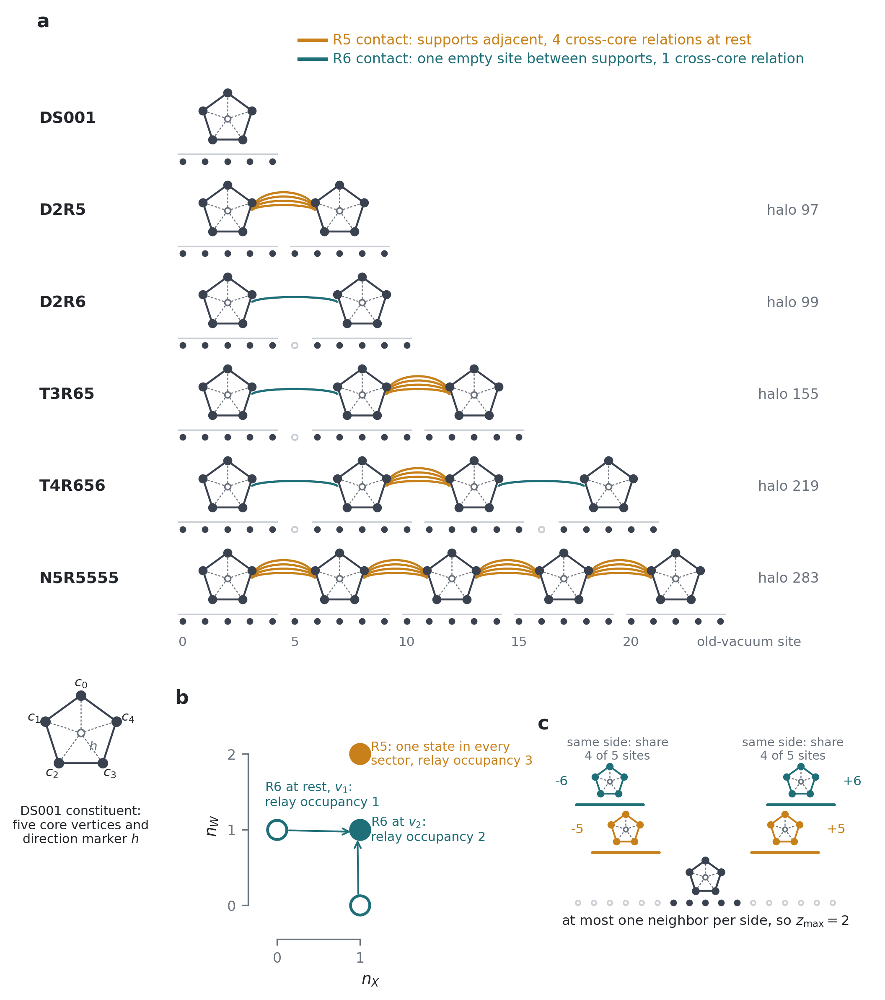

**Figure 3.** (a) Stationary-rest layout of DS001 and representative composites. Each constituent is drawn as a pentagon glyph (five core vertices c0–c4 with the direction marker h at the center; key at lower left), placed above the five consecutive old-vacuum sites it occupies (dots below; open circles are unoccupied sites). An R5 contact places two supports side by side and carries four cross-core relations at rest (orange arcs); an R6 contact leaves one empty site between supports and carries one cross-core relation (teal arc). Right: union halo size. (b) Bond-local relay microstates of the finite automaton: R5 occupies one state, (n_X, n_W) = (1, 2), in every kinematic sector; R6 occupies a low state at rest and v1 and the high state (1, 1) at v2. Relay occupancy counts relay relations of the two grammar-defined classes and differs from the total cross-core count in (a). (c) Coordination bound: the admissible neighbor offsets are −6, −5, +5, +6; same-side candidates share four of five sites, so at most one neighbor fits per side and z_max = 2.

By Stage Y80 the qualified complete-manifold set contained eight identities: DS001 plus seven composites. The N=4 census alone contributed three four-body species, and the complete stationary population passed 432/432 registered contexts and 8,640/8,640 measured proper periods. Species discovery was kept separate from the later mass-energy analysis: these identities were admitted by recurrence and kinematic closure, not by fitting an energy or inertial observable.

The resulting objects should be described as *particle-like recurrent carriers* rather than physical particles. They are prescribed constructions in an engineered rewrite grammar; native nucleation from generic vacuum dynamics has not been established. Their significance is narrower and more useful: the model contains a stable enough recurrent population on which structural, kinematic, and conservation questions can be posed without redefining the object from stage to stage.

### 6.2 Bond behavior reduces to a small local causal-role automaton

The composite dynamics initially appeared to require species-level or chain-level bookkeeping. Stages Y117–Y119 instead reduced the mature bond behavior to a local finite transducer derived from literal causal roles of the Y33 grammar.

For each adjacent bond, Y118 defines a state

\[
S=(n_X,n_W),
\]

where `X` and `W` count two grammar-defined relay relation classes that simultaneously touch the two constituent cores. Absolute vertex labels, translation, species identity, chain position, neighboring bond type, and historical output-slot names are not part of the state. Only four role-resolved microstates occur on the qualified manifold:

\[
R5=(1,2),\qquad R6_W=(0,1),\qquad R6_X=(1,0),\qquad R6_{XW}=(1,1).
\]

Blind validation places all 4,032 preserved N5 before/after states in this state set and reproduces all 4,032 state transitions exactly. Y119 then derives the relay roles from the literal grammar and adds only one local scheduler-order bit, \(\kappa\), indicating which of the two neighboring constituents updates first. With that input the full local state-and-current transducer predicts 4,032/4,032 N5 transitions exactly. Formal minimization leaves four role-resolved states and three constitutive states after relay orientation is projected away.

This result is stronger than a global empirical fit: a large part of the composite transport law is generated by a finite local causal-role machine. Its scope is nevertheless on-manifold. The result is conditional on the established DS001 phase/action program and does not prove that every arbitrary Y33 history remains within those states.

### 6.3 Renewable coordination is bounded by two on the tested local shell

The finite bond law raises a natural structural question: how many renewable contacts can one constituent support simultaneously? Y121 and Y122 answer this by two substantially different constructions.

Y121 begins from the qualified local R5/R6 placements. A DS001 support occupies five old-vacuum vertices, so the four local candidate neighbor offsets are \(\{-6,-5,+5,+6\}\). Same-side alternatives overlap in four support vertices, which makes every degree-three subset geometrically illegal before bond competition is even considered. The maximum disjoint neighbor count is therefore two. The bound is dynamically saturated: the two admissible left-R6 geometries form and sustain two simultaneous valid relay edges in 48/48 contexts, with 768/768 exact scored edge transitions.

Y122 removes the scalar-coordinate assumption. It constructs a graph-local contact atlas directly from the radius-two two-section neighborhood around a recurrent carrier core. Fifty compact candidate supports spanning 30 oriented causal-role classes are screened without using scalar center separation as the inclusion criterion. Full validation leaves exactly four robust bidirectional contacts—the same four later recognizable as offsets \(-6,-5,+5,+6\). Their compatibility graph is exactly \(K_{2,2}\), whose maximum clique is two.

The agreement of these two methods supports an on-manifold coordination bound

\[
z_{\max}=2
\]

within the finite compact contact shell. This is not interpreted as physical valence, spin multiplicity, Pauli exclusion, or a universal theorem over arbitrary off-manifold embeddings.

### 6.4 Mature constitutive recurrence sheds formation history

A separate question is whether a mature bond must remember how it formed. Y130 compares successfully formed R5/R6 contacts with different formation coordinates and finds that their mature constitutive futures are identical from the first scored mature boundary: 384/384 individual mature transitions across two centers obey the same Y119 transition/current/displacement law for the corresponding relay family and sign.

The surrounding graph can initially retain formation-dependent dressing. That dressing recedes outward: radius-zero local state is already common at the first mature boundary, while progressively larger neighborhoods converge after a finite number of mature sections.

Y131 then tests causality directly. After mature convergence, the residual formation fossils can be deleted without changing the tested local future. Across the two centers, deletion leaves 416/416 local matched states exact and 384/384 mature transitions exact. A larger fossil-star deletion likewise leaves the constitutive recurrence intact.

The correct conclusion is therefore deliberately narrow:

> **The mature bond's constitutive recurrence does not require its formation fossil.**

This does not imply that formation leaves no trace anywhere in the environment. The later D37 two-particle program demonstrates that an external preparation-dependent environmental remnant can remain and affect a different carrier that subsequently passes through the region. The two findings concern different objects: Y130–Y131 address the mature bond's own constitutive future; D37 addresses external environmental memory.

**Primary evidence for Section 6:** Stage Y80 complete-manifold report; Stage Y118 minimal relay-automaton report; Stage Y119 symbolic relay-closure report; Stage Y121 coordination report; Stage Y122 graph-local contact atlas; Stage Y130 mature-state sufficiency report; Stage Y131 causal-wake decoupling report.

---

## 7. Results II — Autonomous kinematics and environmental speed control

### 7.1 From scripted recurrence to a structural carrier engine

The early FBCL carrier program contained procedural scaffolding: numeric labels, external phase information, cleanup tables, and scheduler-sensitive helper operations. Stages Y136–Y148 progressively replaced those dependencies with current relational state and causal ancestry. The endpoint is an autonomous carrier/rest engine on the tested manifold in which phase, direction, successor selection, and cleanup identity are relationally encoded rather than supplied by an external trajectory script.

Relabel covariance was a central filter rather than a cosmetic test. Y142's reconstructed intrinsic relay passes 11,520/11,520 arbitrary relabelings, while the older scalar arithmetic formula reproduces the mapped result in only 2/11,520 cases. The later rest-engine integration, as currently documented in the companion synthesis, passes 640/640 long-run periods, 560/560 arbitrary relabeling checks, and 28/28 rest-to-motion handoffs.

These results establish **carrier-rule autonomy and relabel covariance on the tested manifold**. They do not establish causal invariance of the complete rewrite system. The global event scheduler remains sequential, and event order can change outcomes. Multi-particle coexistence later required an explicit recurrence-obligation scheduling rule to protect an established recurrence from a destructive fresh-source competitor. The paper therefore distinguishes intrinsic carrier dynamics from the still-scaffolded global event-selection layer.

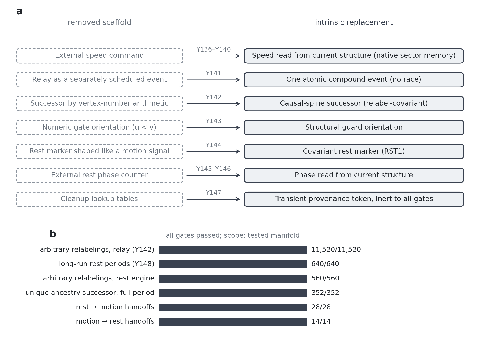

**Figure 4.** (a) Each piece of experimental scaffolding removed during Y136–Y147 (dashed, gray) and the intrinsic structure that replaced it (solid), with the stage that made the change. (b) Validation gates for the frozen engine; every gate passed on the tested manifold.

### 7.2 A specific environmental relation causally controls the speed classifier

Once the carrier engine was structural, the environment could be interrogated causally. Y159 separates two visually similar environmental channels. Deleting the bond-adjacent environmental relays does not change intrinsic carrier selection in 0/56 tested cases. By contrast, deleting one distinct `SECTOR_ENV` relation per constituent reclassifies the carrier's intrinsic sector in 88/88 observations, with the displacement response following one macro-round later.

This provides an explicit upstream environmental handle on the carrier's graph-defined kinematic sector. It is not a velocity command: the intervention modifies relations in the graph, after which the unchanged carrier engine selects and maintains the new recurrence pattern. The two environmental channels and their different causal roles are summarized in Figure 5.

### 7.3 Environmental deletion produces autonomous acceleration

Y160 tests the causal implication of that channel across seven species, two geometries, and both signs: 28 registered cases. A finite deletion of the relevant environmental sector relations causes the carrier to move from the \(v_1\) recurrence to the \(v_2\) recurrence in 28/28 cases. Only the initial finite intervention is applied; the faster recurrence then self-maintains through the scored interval. Untreated controls remain on \(v_1\).

The transition is not instantaneous. The observed sequence passes through a \(|v|=3/2\) pattern before reaching \(|v|=2\). The two-round staircase has a direct causal mechanism: each compound carrier event selects its gate from the **pre-event** relational geometry, so deleting a sector-defining relation cannot alter the event already selected; it can only alter the next event, whose rewritten geometry then supplies the following step. The sequence \(1\rightarrow 3/2\rightarrow 2\) is therefore the expected consequence of the update order rather than an unexplained response lag. A pulse-only branch that does not complete the full deletion program fails to settle at \(v_2\) and instead remains on an alternating period-two pattern. Y161 extends that intermediate state to 128 rounds and validates it in 16/16 D2/T3 contexts, with 1,792/1,792 same-parity recurrent closures. It is therefore a genuine third autonomous kinematic structure of the model, not merely a transient numerical average.

### 7.4 Reversible two-speed control

The reverse transition initially exposed a sign asymmetry. The first return recipe worked for one propagation sign and failed for the other because a second outside source created an ambiguous sector state. The successful resolution at Y163 was not a new attachment coordinate but an occupancy condition: retain an already valid source when present and insert one only when none exists.

With that occupancy-guarded environmental source operation, repeated \(v_1\leftrightarrow v_2\) control succeeds across the full tested population. The strongest population gate is the N=5 completion: 44/44 cases pass the four-leg sequence

\[
v_1\rightarrow v_2\rightarrow v_1\rightarrow v_2\rightarrow v_1,
\]

for 176/176 intervention legs, with 44/44 independent 256-round untreated controls and 22,528 exact graph comparisons. The intervention is externally triggered, but the resulting recurrence is maintained by the unchanged carrier engine rather than by continuous forcing.

The same program also produced a preregistered settling-time law. The first CQ1 reference match after return to \(v_1\) was predicted as

\[
t_{\rm first}=\left(\sum \text{bond spacings}\right)+4.
\]

For the N=5 chains this is equivalently \(t_{\rm first}=24+n_{R6}\). The prediction is confirmed in 24/24 T4 cases and then 44/44 N5 cases. It was not used as a pass criterion. This matters methodologically: settlement was predicted before the relevant population result was opened rather than defined after observing the trajectories.

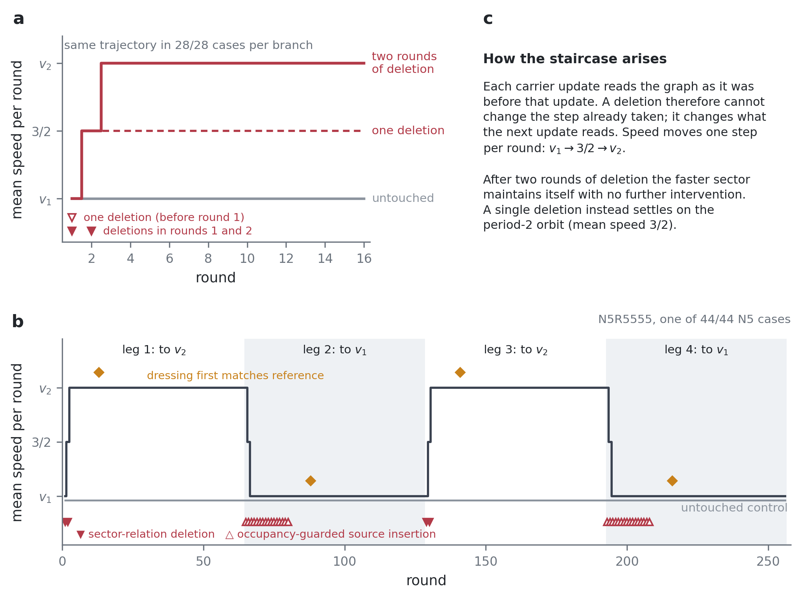

**Figure 5.** (a) Mean carrier speed per round after environmental intervention (Y160, D2R5 shown). Untouched carriers stay at v1; one deletion moves the carrier onto the period-2 orbit (mean 3/2); deletions in two consecutive rounds move it to v2, where it stays with no further intervention. Each branch follows the identical trajectory in all 28 cases (7 species × 2 geometries × 2 signs). (b) Repeated four-leg control for N5R5555 (Y163, one of 44 N5 cases): sector-relation deletions (▼) drive v1 → v2 and occupancy-guarded source insertions (△) drive v2 → v1. Diamonds mark the first round at which the dressing matches its reference: round 13 after reaching v2 and round 24 after returning to v1, as predicted by the settling law 24 + n_R6 with n_R6 = 0. The untouched control (gray, drawn slightly offset for visibility) stays at v1 for all 256 rounds. (c) Why the response is a one-step-per-round staircase.

### 7.5 Interpretation and limitations

The positive kinematic conclusion is substantial but bounded:

> **In the tested FBCL/Y33 architecture, local environmental graph state can select among several autonomously maintained recurrent motion sectors without direct assignment of velocity.**

Three qualifications remain central.

First, the trigger is external; these experiments do not demonstrate a spontaneous force law. Second, the carrier is prepared by a prescribed construction rather than nucleated naturally. Third, the global scheduler remains sequential and non-causally-invariant. These limitations are part of the result, not footnotes to be removed in a later polish pass.

**Primary evidence for Section 7:** Y142 checkpoint; current Y148 companion synthesis pending primary report; Y163 N5 completion checkpoint; Y164-A inherited-evidence checkpoint for Y160/Y161; current companion Appendix D for the Y159–Y163 numerical chain.

---

## 8. Results III — The mass-energy question

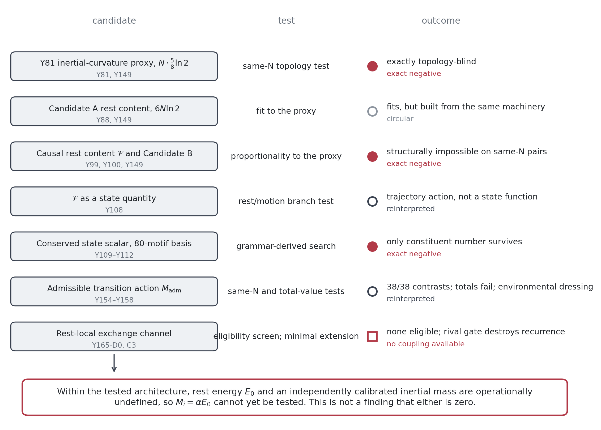

**Figure 6.** Each candidate mass or energy observable, the test it faced, and its outcome, marked by kind: exact negative (filled red), circular (open gray), reinterpreted (open slate), or no coupling available (open red square). The program ends with rest energy and an independently calibrated inertial mass operationally undefined in the tested architecture, which is not a finding that either is zero.

### 8.1 A useful curvature proxy that is exactly topology-blind

The project originally sought a quantity that could play the role of inertial mass by measuring the cost of changing a recurrent carrier's motion. One model-internal quantity surviving that program is the Y81 curvature proxy. In the notation used here it is

\[
M_{\rm curv}=N\,\frac{5}{8}\ln 2,
\]

where \(N\) is the number of DS001 constituents. The notation `M_curv` is used deliberately: later Y165 work shows that an independently calibrated inertial mass has not been operationally established.

Y149 re-evaluates the proxy after the complete autonomous-engine rebuild. The value reproduces exactly and remains purely extensive in constituent count, with zero same-\(N\) binding residual. That stability is useful—it shows the earlier value was not an artifact of the old scripted carrier architecture—but it creates a sharp problem for mass-energy identification. R5/R6 topology-sensitive rest observables differ among same-\(N\) species while \(M_{\rm curv}\) cannot.

Thus any proposed universal proportionality between this curvature proxy and a topology-sensitive rest-content observable fails structurally on same-\(N\) controls. The mismatch is not a poor fit that might be repaired by another global coefficient; the two quantities encode different information.

### 8.2 Direct searches for conserved recurrence content

A second line of attack asks whether recurrence energy can be identified as a conserved structural state quantity. Y109–Y112 progressively replace intuitive inventories with grammar-derived conservation tests. Y112 evaluates an 80-dimensional structural motif basis and finds that the only genuine dynamic balances surviving the qualified population are

\[
I_{\rm out}=8N,
\qquad
I_{\rm in}=16N.
\]

The two are not independent on the measured states, and both reduce exactly to constituent/support number. Under the preregistered triviality criterion they are therefore not promoted as recurrence energy.

This is a strong negative result within the tested basis, but it remains basis-bounded. It does not exclude nonlinear, history-dependent, or exchange-defined conserved quantities outside the 80-dimensional state representation.

A later and logically different conservation test reaches the same operational caution. D3-7H constructs a coefficient-free signed causal-role transaction ledger for a two-carrier response and correctly predicts whether partner history adds or removes the receiver's future source-role occupancy. Yet all four predeclared simple source-side conservation candidates fail prospectively: direct partner-live, direct total-live, subtractive partner-live, and subtractive total-live balances are each 0/4. The ledger is useful causal bookkeeping, but it is not a conserved energy-like scalar. This is an independent negative basis from the Y112 state-invariant search.

### 8.3 A striking topology-contrast correspondence—and why it is not mass-energy equivalence

Stages Y150–Y155 shift from static state candidates toward action accumulated along autonomous admissible rest-motion-rest paths. The sign history matters, and the two stages do **not** measure the same action with only a sign flip. Y151's forward-only cross response obeys

\[
\Delta M_{\rm cross}=\frac{171}{16}\,\Delta B_{\rm proj}=-\frac{171}{16}\,\Delta\mathcal F_{\rm flux}.
\]

Y155 instead evaluates a different quantity, the genuinely closed admissible-path action, and obtains

\[
\Delta M_{\rm adm}=\frac{277}{48}\,\Delta\mathcal F_{\rm flux}=-\frac{277}{48}\,\Delta B_{\rm proj}.
\]

The structural pattern survives—the two comparators again enter with equal and opposite coefficients—but the alignment reverses and the coefficient changes. The paper therefore treats Y155 as the closed-path correction governing the later interpretation, not as a silent replacement of the Y151 number.

After the admissible paths are properly closed, Y155 obtains a precise same-\(N\) topology contrast. One calibration point fixes a scale

\[
\kappa=\frac{277}{48},
\]

which then transfers with zero refitting across all 38/38 same-\(N\) pairwise comparisons in the tested population:

\[
\Delta M_{\rm adm}
=
\frac{277}{48}\,\Delta\mathcal F_{\rm flux}
=
-\frac{277}{48}\,\Delta B_{\rm proj}.
\]

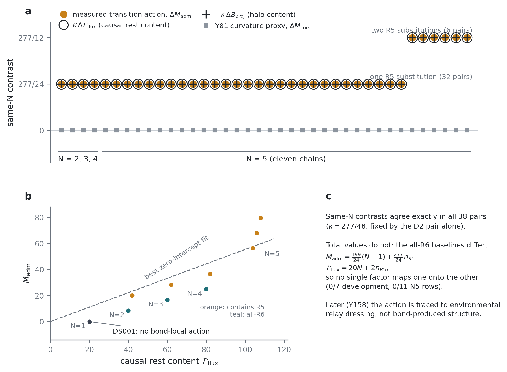

**Figure 7.** (a) All 38 same-N pairs in the tested population, each shown separately. For every pair, the measured transition-action contrast (orange) coincides exactly with the scaled causal rest-content contrast (open circle) and the scaled halo-content contrast (dark cross), with κ = 277/48 fixed by the D2 pair alone. The Y81 curvature proxy (gray squares) is zero for every pair. (b) Total values do not correspond: M_adm against F_flux for all 19 identities, with the best zero-intercept fit (dashed). Each constituent count lies on its own line because the all-R6 baselines differ, and DS001 has no bond-local action. (c) Summary, including the Y158 reinterpretation.

The result is real but deliberately not called total mass-energy equivalence. The zero-intercept total-value gate fails on all development and N5 rows, and DS001 itself has zero bond-local admissible action while the rest-content candidates are nonzero.

More importantly, Y156–Y158 change the interpretation of what that action means. Current-incidence accounting double-counts ownership migration, and a producer-owned decomposition shows that strictly bond-produced action is exactly zero for R5 and R6 in the tested dimers. The Y154/Y155 contrast signal therefore reflects **environmental relay-incidence dressing**, not intrinsic bond birth/death content.

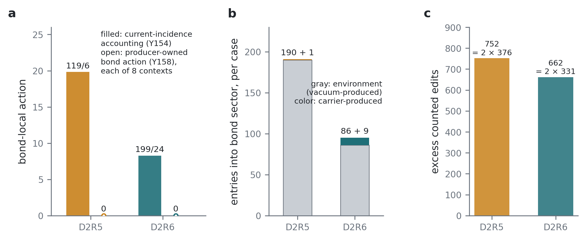

**Figure 8.** (a) Bond-local action for the two dimers under current-incidence accounting (Y154, filled) and under producer-owned accounting (Y158, open; each of eight sign/geometry contexts). Producer-owned bond action is exactly zero for both bond types. (b) Entries into the bond-incidence sector per case: almost all are pre-existing environmental relations (gray), not carrier-produced ones (color). (c) Current-incidence accounting overcounts by exactly two edits per channel migration.

This is a useful example of a result surviving numerically while changing scientifically. The 38/38 contrast law is retained; the earlier interpretation of the correlated quantity as bond-built material content is not.

### 8.4 Why activity is still not operational energy

The later Y165-C program returns to a more demanding operational definition. A candidate rest energy should not merely be stable or topology-sensitive; there must be a local interaction through which something can be exchanged with a resting carrier while preserving the carrier, together with an independently measurable environment-side ledger. Without such a channel, multiplying recurrence activity by a frequency does not establish energy.

The original-law eligibility screen Y165-D0 tests DS001, D2R5, and D2R6 through complete stationary rest cycles and searches every preregistered class of independent safe local environmental operation near the carrier. No eligible independent rest-local operation is found. The native rest recurrence itself has a unique ancestry-qualified next gate; mandatory maintenance is not an external probe.

Y165-D1/D2 nevertheless show that producer-owned recurrence activity is reproducible. The measured lifetime-area values are **160 for DS001, 316 for D2R5, and 320 for D2R6**. D2R6 is therefore **exactly twice** DS001, while D2R5 is exactly four units lower than D2R6. That constituent scaling plus the R5/R6 residual makes the observable topology-sensitive enough to be scientifically interesting, but it is not promoted to \(E_0\): no independent exchange channel has been demonstrated, no conservation law closes around it, and no path-independence property has been established. It remains an activity proxy rather than exchangeable energy.

C3 then tests the most conservative existing-grammar extension: fire one already-legal local rival Y33 gate once and return immediately to the native rest engine. Six of eight phases contain exactly one such rival. All six fail identically: rival and native gates share four of five vertices, the rival consumes the causal support required by the next rest update, and the native rest-role solver returns zero valid assignments. The untouched control completes two full rest cycles normally.

C3 therefore does not show that external work has zero effect. It shows that the obvious syntactic rival is not an independent work channel at all; it competes with the unique recurrence mechanism that constitutes the particle's next step.

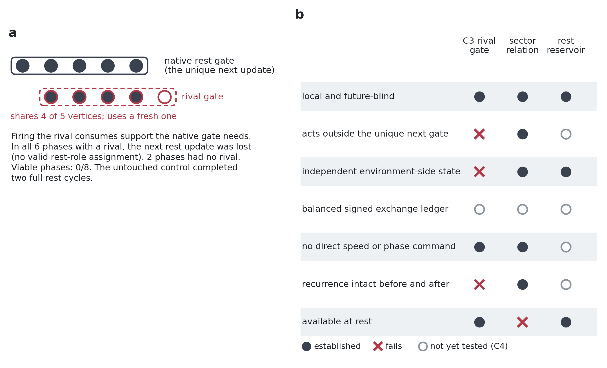

**Figure 9.** (a) Why the C3 probe fails: the only legal rival to the native rest gate shares four of its five vertices, so firing it consumes support the native gate needs. In all six phases with a rival, the next rest update was lost; two phases had none, giving 0/8 viable phases. (b) Requirements for a legitimate rest-local coupling, scored against three existing channels. Filled: established by a completed stage; cross: fails; open: not yet tested (the subject of the planned C4 audit).

### 8.5 Present operational conclusion

The mass-energy result of the present model is consequently negative but precise:

\[
E_0\;\text{is operationally undefined},
\]

\[
M_i\;\text{as an independently calibrated inertial response is operationally undefined},
\]

and therefore a population law

\[
M_i=\alpha E_0
\]

is not yet testable.

This is not a claim that the carriers have zero rest energy or zero inertial mass. It is also not a theorem excluding every possible future coupling architecture. It is the narrower statement that the **tested original CRR architecture does not presently provide the independent rest-local exchange channel needed to define and calibrate those quantities without circularity**.

That conclusion is scientifically useful in its own right. The program has recurrent matter-like structures and autonomously maintained kinematic sectors, but the step from recurrence/kinematics to operational mass-energy remains uncompleted.

The planned C4 study is therefore a bounded design audit, not another open-ended simulation search: existing environmental channels should first be scored against explicit locality, covariance, scheduler-independence, preparation-independence, reversibility, and balanced-ledger criteria before any new coupling law is introduced. Any added coupling must be reported as an extension of CRR rather than retroactively attributed to the original model.

**Primary evidence for Section 8:** Stage Y112 conservation-law report; Y149 primary `Y149_MI_ALL.csv` / `Y149_KEY_RESULTS.csv`; Y151 primary transition-decomposition report; Y155 primary comparator/pairwise tables; Y158 producer-owned action report; Y165-D0 final checkpoint; Y165-D2 final checkpoint; Y165-C3 final checkpoint.

---

## 9. Results IV — Two-particle case study: from apparent wake to preparation-dependent formation memory

### 9.1 Why the two-particle branch mattered

The D37 program began because an isolated carrier cannot reveal whether another carrier can alter its recurrence. Initial pair runs produced a reproducible trailing-receiver response: with a leader ahead in the common direction of travel, the receiver changed speed in pair worlds but not in matched solo controls. The first plausible description was a wake or partner-mediated interaction.

The value of the D37 sequence is not that this initial interpretation survived. It did not. The sequence is a case study in how progressively stronger controls can turn an apparent interaction into a more limited but better-supported causal classification.

### 9.2 Recent leader motion and compact formation fossils are not the carrier

Aged-origin tests move the leader far away while placing the receiver back at the original geometry. The response persists even though recent autonomous leader motion has no causal arrival at the receiver before onset. Deleting the compact formation fossil likewise does not remove the response, and larger excess/deficit structures around the receiver's starting point prove causally dispensable.

Those results rule out several simple pictures at once. The effect is not carried by the leader's recent trajectory, not by the compact fossil identified in the earlier formation-history studies, and not by the most obvious radius-eight pair/solo boundary differences around the receiver's initial location.

A scheduler audit then reveals an important confound: pair and solo worlds have different global legal-gate populations, so the shared global scheduler can cause different background events even where no current-leader causal lineage arrives. However, a controlled RNG crossover shows that changing the initial scheduler RNG changes global timing and later history but not the first receiver anomaly when indexed by the receiver's own recurrence steps. The onset is therefore receiver-progress locked rather than global-time locked.

### 9.3 Prospective worldline mapping localizes the response to the old formation region

D37O changes the geometry of the question. Instead of looking for a signal propagating from the leader toward the receiver or for a static difference around the receiver's insertion point, it asks what structural difference lies **along the receiver's future path**.

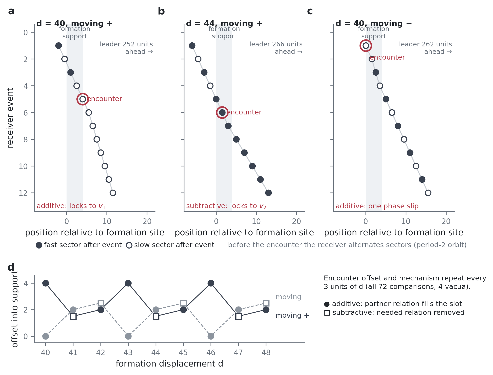

**Figure 10.** (a–c) Receiver worldlines in three D37Q cases, plotted against position relative to the leader's original formation site (shaded: the five-site formation support). Filled and open markers show the receiver's sector after each event; before the encounter it alternates (period-2 orbit). At the encounter (red ring) the receiver locks to v1 (a, additive), locks to v2 (b, subtractive), or slips phase once (c, additive). The leader is 252–266 units ahead at that moment. (d) Encounter offset into the formation support and mechanism for every displacement d = 40–48 and both directions: the pattern repeats every 3 units of d, matching the 3-unit advance of the period-2 orbit per two events.

The relevant footprint is not an arbitrary graph-radius ball. It is the exact native source slot read by the receiver's next recurrence. At scored start, the pair and solo worlds are mapped prospectively along the receiver corridor before either the native reference or the scheduler-bypassed clamp is run. The map predicts the first receiver event, position, transaction sign, and causal-role mechanism.

On the D37O fresh population, all 8/8 predictions are exact under the receiver-only clamp, and all 8/8 ordinary native references hit the same predicted encounter. This establishes that no further global scheduler event is required after the scored start: the receiver can reach the response using only its own native recurrence.

D37P then varies the formation displacement. Its strict provenance-qualified law does not close across the full two-sign population, but wherever the map qualifies it is exact. Post-verdict forensics suggest the raw occupancy map is more robust than the narrow provenance rule, motivating a clean separation between immediate local predictor and historical origin.

D37Q performs the decisive prospective sweep over every integer displacement \(d=40\ldots48\), both signs, four fresh vacua. All 72/72 P000 source-slot maps predict the ordinary native onset exactly in receiver-event index, receiver position, role sign, and independent sector sign. The same absolute source-slot difference is already present at the earlier post-warm cut; the early clamp reaches it 17 receiver events later than the P000 branch because qualification has advanced the receiver, not because qualification created the remnant. Source-slot normalization at three anchor displacements abolishes the native anomaly in all 24/24 interventions.

Within the D37Q population, the onset is therefore a local **worldline encounter**: the receiver changes recurrence when it reaches a pre-existing source-slot condition in the old leader-formation region.

### 9.4 Fresh holdouts limit the universality of the formation-site law

D37R is essential because D37Q's 72/72 result can easily be overread if considered alone. D37R introduces four fresh vacua, spans one complete displacement/phase period, and compares two legitimate preparation methods that produce an exactly matched mature leader state before aging.

For each preparation method separately, the local P000 occupancy map remains an excellent immediate predictor: it predicts the method's own native outcome in 24/24 cases, including nulls. But the inherited D37Q three-coordinate law is reproduced in only 19/24 cases for each method and in only 17/24 cases simultaneously. The two preparation methods produce the same map/native response in 20/24 comparisons and differ in 4/24 close negative-motion geometries, despite matching the mature leader's core tuple, marker, magnitude, position, constituent RNG state, and complete live relation star.

Three additional fresh \(d=40,-\) cases are null under both methods. These are not preparation-method disagreements; they are fresh-holdout failures of the earlier universal non-null Q pattern at the smallest negative displacement.

This changes the correct wording of the D37 result. The local source-slot occupancy-response relation is robust. The exact remnant pattern supplying that occupancy is not preparation-method invariant.

### 9.5 Upstream surgery supports causality but does not close a universal interaction gate

D37R also traces the eventual source-slot difference backward through formation and aging. A persistent pre-receiver root is found in 21/24 comparisons. When that root can be normalized without preventing formation of a healthy mature leader, the later response changes in all 15/15 viable surgery cases: 13 are abolished over the full native run and two shift to a different onset.

The result is strong causal evidence for those viable branches, but the fully controlled gate remains open because six root surgeries disrupt later leader formation, three cases have no persistent root, and the preregistered matched non-corridor control is structurally available in only one case. No looser control is introduced after seeing the outcomes.

### 9.6 Final classification

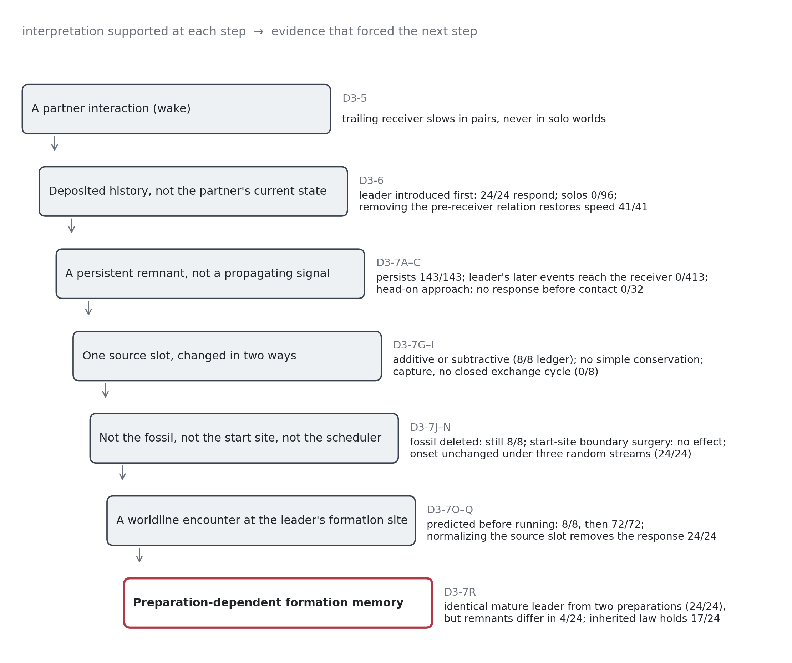

**Figure 11.** The interpretation of the two-carrier response at each step of the D37 program, and the evidence that moved it to the next step, from an apparent partner interaction to preparation-procedure-dependent formation memory.

The final D37 classification is therefore

\[
\boxed{\text{preparation-procedure-dependent formation memory}}.
\]

The receiver does not respond to a contemporaneous field emitted by the remote mature leader. It encounters a local environmental condition along its worldline in the old formation region. That condition can be causally important, but its detailed pattern depends partly on how the leader was prepared even when the mature leader itself is matched.

D37 consequently does **not** establish a preparation-independent particle-particle exchange field, conserved momentum transfer, rest energy, gravitational attraction, or any mass-energy law. Its strongest scientific contribution to the present paper is methodological and causal: an apparent delayed interaction was reduced to a local worldline encounter and then further limited by a preparation-invariance test.

The mass-energy ledger therefore remains closed after D37, and the branch is retired from the current energy program unless an independently established native formation process becomes available.

**Primary evidence for Section 9:** Y165-D37Q final checkpoint and audit; Y165-D37R final checkpoint and audit; current Section 10A synthesis for the earlier D37 reinterpretation chain.

---

## P4 drafting notes for the next pass

1. **Do not restore the older D37Q universal wording.** D37R is the governing interpretation: Q's 72/72 law is exact in its population but not universal on the fresh R holdout population.
2. **Do not call `M_curv` inertial mass.** It is a topology-blind curvature proxy whose later comparison motivates the need for an independent response assay.
3. **Keep Y155 and Y158 together.** The 38/38 numerical correspondence survives; the intrinsic-bond-action interpretation does not.
4. **Keep environment-controlled speed distinct from spontaneous force.** The Y160–Y163 interventions are externally triggered changes to graph state followed by autonomous recurrence.
5. **Keep Section 6 formation-history shedding distinct from Section 9 formation memory.** The former is a statement about the mature bond's constitutive future; the latter is an external environmental remnant encountered by another carrier.
6. Before final manuscript lock, surface primary Y148, Y149, Y155, and Y158 reports if available and replace the current synthesis-status source notes in the claims ledger.

---

# CRR Paper P5 — Draft Sections 10–13

**Working title:** *Persistent particle-like structures, autonomous kinematics, and no established operational mass-energy in an engineered hypergraph rewriting system*

**Draft status:** Paper-framework draft. These sections are intended to follow P4 Sections 6–9. Literature-dependent novelty claims remain out of scope until the dedicated literature pass.

---

## 10. Scaffolding audit: separating substrate behavior from experimental apparatus

### 10.1 Why a scaffolding audit is necessary

The rewrite grammar is the object of study. Nearly everything required to perform an experiment on that grammar—particle insertion, preparation schedules, event selection, speed classifiers, bond-seeding motifs, graph observers, bookkeeping variables, and intervention triggers—is experimental apparatus. In a discrete relational system, small changes in such apparatus need not average away. A numerical convention, preparation history, or scheduler rule can alter the exact set and order of legal local events and thereby create an effect that resembles intrinsic dynamics.

This investigation encountered that problem repeatedly. Several initially promising results survived their first controls but were later reclassified when a more specific scaffold-removal test became available. The purpose of this section is therefore not to catalog mistakes separately from the science. The sequence of detection and correction is itself part of the scientific method used here.

The recurring pattern was:

\[
\text{apparent effect}
\;\longrightarrow\;
\text{candidate scaffold}
\;\longrightarrow\;
\text{targeted removal/control}
\;\longrightarrow\;
\text{revised intrinsic claim}.
\]

A result was retained only at the strongest level that survived this process.

### 10.2 Representation and coordinate scaffolds

Some of the earliest failures were representational rather than dynamical. Apparent turnaround memory in Y59–Y71 contained a large component that reduced to relabeling along the vacuum coordinate. Later bond descriptions in Y117–Y126 initially depended on output-slot labels and opaque signature hashes. Replacing those encodings with explicit causal-role counts, producer-spine structure, and graph-local variables reduced the description to a finite local automaton.

The most direct covariance failure occurred at Y142. A candidate intrinsic relay rule that appeared structural in its native numbering survived only 2 of 11,520 arbitrary relabelings. Rebuilding it from causal-spine relations produced the relabel-covariant form used in the later engine. This episode establishes an important distinction used throughout the paper: invariance under vertex relabeling is a necessary representation test, but it is not the same as causal invariance under alternative event orders.

A related issue occurred in the rest architecture. Numeric gate-orientation conventions hid legal exits, and cleanup identities were initially stored in pointer tables outside the relational state. Those scaffolds were progressively removed by covariant gate enumeration and by replacing external cleanup bookkeeping with transient relational state that is inert outside its intended role.

The resulting lesson is stronger than “avoid numeric labels.” Any variable proposed as intrinsic must be reconstructed from current relational state and causal provenance, and must survive explicit relabeling tests with a negative control capable of detecting a label-dependent construction.

### 10.3 Event-order and scheduler scaffolds

The system is not causally invariant: changing event order can change the resulting state. Consequently, scheduling is not merely an implementation detail.

This first became operationally important when locally correct carrier transitions lost races to competing legal events. Y141 and Y145 showed that a structurally correct selector could still fail if represented as a separate scheduled event. The remedy was not to reinterpret the failure as noise, but to change event granularity explicitly by folding the required local transition into one atomic compound event.

The multi-particle Y165 program exposed a deeper scheduler issue. The global simulator selects the next event from the set of legal gates over the whole world. Adding a remote particle therefore changes the legal-gate population and can alter background event order near a receiver even before any causal lineage from that particle arrives. D37M identified this as a genuine confound. D37N then weakened—but did not erase—the scheduler explanation: changing the initial scheduler RNG altered global timing and later history, but did not alter the receiver-step index of the first anomaly.

The current interpretation is therefore deliberately limited. The carrier's local recurrence rules can be relabel-covariant and autonomous on their tested manifold while the enclosing world evolution still depends on a global sequential scheduler. Claims about locality, interaction, or causal propagation consequently require either a scheduler-matched control, a scheduler-bypass construction, or a future causally local update scheme.

### 10.4 Measurement and ownership scaffolds

A second recurring failure mode was to mistake an observer-dependent decomposition for a physical quantity.

The Y154–Y155 transition-action program produced an exact same-\(N\) topology-contrast correspondence. Subsequent accounting tests showed that one proposed self-plus-bond decomposition double-counted ownership migration. More importantly, Y158 established that strict producer-owned bond action is zero on the tested bonds. The numerical Y155 contrast survives, but its interpretation changes: it describes environmental relay-incidence dressing associated with topology, not intrinsic bond-created action.

The correction is scientifically more useful than discarding the old number. It distinguishes a reproducible structural correspondence from the stronger physical interpretation that the correspondence initially seemed to support. That distinction is why Section 8 reports Y155 and Y158 together.

### 10.5 Preparation scaffolds and the D37 reclassification

The D37 sequence provides the clearest example of progressively stronger scaffold removal.

A trailing receiver initially appeared to respond to a leader's wake. Preparation-sham controls ruled out the simplest bookkeeping explanation. Aged-leader tests then ruled out recent leader motion as the carrier of the effect. Compact formation-fossil deletion and larger boundary surgeries ruled out several obvious static structures. Scheduler crossover showed that the shared global scheduler changes timing but not the receiver-relative onset.

The decisive shift came from mapping the receiver's future native source slot rather than looking for something propagating backward from the current leader. D37O–Q showed that the receiver encounters a pre-existing local condition near the old formation region. Source-slot normalization removes the response. But D37R then showed that two legitimate preparation procedures yielding an exactly matched mature leader can leave different remnants in 4 of 24 close geometries, and the precise D37Q formation-site pattern is only partly reproduced on fresh holdouts.

The final classification is therefore not “interaction law” but **preparation-procedure-dependent formation memory**. The local occupancy-response relation is robust; the remnant supplying that occupancy is not a preparation-independent property of the mature leader.

This is precisely the kind of result the scaffolding audit is intended to preserve: the phenomenon remains real inside the simulation, but its scientific category changes when the preparation scaffold is varied.

### 10.6 Coupling scaffolds and the C3 fail-fast result

The latest mass-energy branch provides a related warning. Y165-D0 found no eligible safe independent rest-local action under the original Y33/Y148 dynamics. C3 then tested the most conservative existing-grammar extension: one additional legal rival Y33 fire followed by immediate return to the native rest engine.

That intervention failed in every eligible phase because the rival overlaps four of the five vertices of the unique next rest gate. Once the rival fires, the native rest representation disappears. This is structurally the same fresh-source competitor family already identified as destructive in the earlier D3-4 scheduler work.

C3 therefore does not show that a resting carrier cannot exchange energy. It shows that this obvious existing-grammar probe is not an independent probe at all: it competes for the same causal support that constitutes the particle's next recurrence step.

The resulting hard design constraint is:

\[
\boxed{\text{an admissible rest coupling must act outside the unique next-gate footprint.}}
\]

### 10.7 Scaffolding that remains in the present model

Several important scaffolds have not been removed. Particle-like carriers are still prepared by prescribed procedures rather than nucleated by vacuum dynamics. Multi-particle coexistence relies on the D3-4 recurrence-priority scheduler rule. Environmental speed transitions are externally triggered even though the subsequent motion is autonomous. Preparation and warm-up sequences precede scored runs. The speed classifier, dressing quotient, bond-seeding motifs, and other observers remain human-defined measurement constructions. Independent vacuum seeds only became a routine replication unit late in the program. Most importantly, the world still evolves through a global sequential scheduler in a non-causally-invariant rewrite system.

These are not footnotes to be hidden after the results. They delimit what the current results mean.

### 10.8 Standing scaffold-removal rule

The investigation therefore adopts the following rule for any future positive claim:

> **Before promotion, a new effect must pass at least one preregistered control aimed at the most plausible way the experimental apparatus itself could generate that effect. The control must be capable of succeeding, and the surviving result must be reported together with the control.**

This rule does not guarantee that every surviving effect is intrinsic. It does make the evidentiary burden explicit and creates a mechanism for later stages to revise earlier interpretations without erasing the underlying observations.

---

## 11. What this paper does not claim

The paper reports computational properties of specific rewrite architectures and the results of controlled interventions within those architectures. It does not identify those structures or observables with known physical entities.

| Not claimed | Boundary used in this paper |
|---|---|
| Physical particles | “Particle-like,” “carrier,” and “recurrent structure” refer to persistent computational structures in the tested rewrite systems. |
| A fundamental rule of nature | The later FBCL/Y33 grammar was engineered by search because it supports recurrent carriers. It is an existence construction in rule space. |
| Relativity or causal invariance | Relabel covariance and local carrier autonomy are established on tested manifolds; the global sequential dynamics are not causally invariant. |
| Physically realistic emergent spacetime | Rule 55744's local graph-growth exponent near 4.6 is a finite-scale graph property, not identified with spacetime dimension. |
| Natural particle formation | The principal Y-series carriers are inserted/prepared. Native nucleation from vacuum dynamics has not been established. |
| Spontaneous force from environmental speed control | Y160–Y163 use externally applied graph interventions; the later recurrence evolves autonomously, but the trigger is imposed. |
| Physical inertial mass from \(M_{\rm curv}\) | The Y81 quantity is a topology-blind inertial-curvature proxy, not an independently calibrated inertial mass. |
| Rest energy from recurrence/activity proxies | No tested quantity presently satisfies the required independent exchange/response conditions for operational \(E_0\). |
| Zero rest mass or zero inertia | “Undefined” means operationally unestablished in the tested architecture, not numerically zero. |
| A conserved particle-particle exchange field from D37 | D37 is classified as preparation-procedure-dependent formation memory, not a preparation-independent interaction law. |
| Gravitational attraction or an equivalence principle | No validated gravitational source-response law has been obtained. |
| Universality beyond tested manifolds | Finite automata, coordination limits, speed-control laws, and holdout results retain their explicit population and architecture scopes. |

The distinction between “not established” and “shown absent” is central. Some results are exact negatives within a frozen basis or architecture—for example, the topology blindness of \(M_{\rm curv}\), the Y112 linear state-scalar search, or C3's destruction of rest recurrence. None of these is promoted to a theorem about every possible extension of relational rewriting.

---

## 12. Open problems and bounded next steps

### 12.1 Operational mass-energy remains the central unresolved question

The current program has exact recurrent carriers, bonded composite structure, stationary recurrence, and autonomously maintained kinematic sectors. What it does not have is an independent way to exchange a conserved quantity with a resting carrier and then measure a calibrated dynamical response.

Accordingly, the present status is

\[
E_0\;\text{undefined},\qquad
M_i\;\text{independently undefined},\qquad
M_i=\alpha E_0\;\text{not testable}.
\]

The missing object is not another scalar fit. It is a legitimate coupling architecture.

Two already-measured kinematic quantities remain useful **candidate response observables** for any future noncircular coupling test. First, the return-to-\(v_1\) settling lag scales with bond geometry/topology, so it may provide a response that is independent of a proposed transferred quantity. Second, Y160 supplies an important negative control: the exact \(1\rightarrow3/2\rightarrow2\) staircase is universal across the tested species, so that staircase by itself is not inertia-like discrimination. A future Gate-3 experiment should hold the environment-side transfer definition fixed and ask whether a separately defined response—such as settling lag—varies prospectively across species without being built into the coupling.

### 12.2 Y165-C4 as a bounded design audit

C4 is intentionally not an open-ended simulation search. Before adding any new rewrite or selector, it will ask whether an already-characterized environmental channel can satisfy the requirements of an operational rest coupling. The frozen requirements and the C3 gate-overlap failure are summarized in Figure 9.

Two existing channels are natural candidates. The **sector relation** of Y159–Y163 is an independently measurable environment-side state whose modification changes the graph-defined speed sector without assigning a velocity directly; repeated round trips establish substantial reversibility on moving carriers. Its principal deficits are that it acts on moving rather than stationary carriers and has no demonstrated balanced exchange ledger. The **stationary rest reservoir** identified at Y133 is a small repeatedly reused pool of nearby vacuum relations with topology-sensitive rest activity and lies outside the carrier's unique next recurrence gate. It is therefore the more natural candidate for a rest-compatible exchange channel, but no causal intervention and no balanced transfer law have yet been demonstrated for it.

C4 will score candidate channels against ten frozen requirements:

| Requirement | Purpose |
|---|---|
| Local and future-blind | Prevent hidden use of future trajectory information. |
| Outside the unique next-gate footprint | Enforce the structural lesson of C3/D3-4. |
| Explicit environment-side state | Make the external side measurable independently of the carrier. |
| Carrier effect without direct speed/phase command | Prevent the response from being defined by the intervention. |
| Healthy bounded interaction | Preserve carrier identity and exact recurrence before and after the exchange. |
| Reversible or cycle-closing behavior | Distinguish controlled transfer from one-way damage. |
| Coefficient-free balanced signed ledger | Require the putative transferred quantity to close without fitted per-species coefficients. |
| Relabel covariance | Exclude coordinate/identifier artifacts. |
| Global-scheduler independence | Exclude a hidden nonlocal channel through world-wide event selection. |
| Preparation-method independence | Exclude D37-style dependence on how the carrier/environment was constructed. |

The **stop condition** is equally important. If neither existing channel admits such a description without altering the original CRR dynamics, the original model is reported as lacking a demonstrated rest-compatible coupling under the present operational requirements. That is a legitimate endpoint:

\[
\boxed{\text{recurrent particle-like structures and autonomous kinematics, but no operational mass-energy in CRR as specified.}}
\]

Any later rule, selector, environment variable, or conservation law added to satisfy these requirements must be labeled an **extended model**. Its results cannot be retroactively counted as properties of the original CRR architecture.

### 12.3 Circularity guard for any future energy definition

A conservation law can always be manufactured if the interaction and the quantity it conserves are designed together. To prevent that circularity, any future coupling must be frozen before measuring candidate \(E_0\), and it must constrain more than one independently defined observable.

At minimum, a successful extension would require an independently measurable environment-side transfer and an independently measurable carrier-side response. Only after the coupling and transfer ledger survive development and fresh holdout tests should any population-level relation such as

\[
M_i=\alpha E_{0,i}
\]

be opened, with one global \(\alpha\) fit on a development subset and held-out carrier species reserved for prediction.

### 12.4 Native formation and preparation independence

Prescribed carrier insertion remains one of the deepest unresolved scaffolds. D37R demonstrates why this matters: two preparation procedures can produce an indistinguishable mature leader while leaving different environmental remnants.

A native formation mechanism would therefore do more than improve aesthetics. It would supply a physically meaningful preparation ensemble and allow later interaction/coupling tests to ask whether environmental dressing is a reproducible consequence of carrier formation rather than a fingerprint of an insertion recipe.

Until such a mechanism exists, preparation-independence must remain an explicit gate on claims about fields, wakes, long-range interaction, or stored environmental energy.

### 12.5 Causal invariance or a causally local scheduler

The present global sequential scheduler is the largest remaining architecture-wide limitation. Because the rewrite system is order-sensitive, a remote change can alter local background history by changing which legal event is selected next, even without a causal lineage connecting the regions.

Future work could address this in two distinct ways: identify a causally invariant rewrite architecture, or construct a causally local scheduler/update scheme whose locality can be audited directly. Either route would require revalidation of the carrier engine, environmental control laws, and any multi-particle result affected by global event competition.

### 12.6 Emergent geometry and rule selection

The rule-search result establishes that closed full-turnover recurrent structures are possible in a finite ternary family, but rule 55744's measured graph-growth exponent near 4.6 is not physical-like, and the later FBCL/Y33 carrier grammar was selected for carrier behavior rather than emergent large-scale geometry.

A future theory would need both sectors simultaneously: recurrent localized structure and a background geometry with defensible large-scale interpretation. The present paper establishes neither a unique rule-selection principle nor a physically realistic geometry.

### 12.7 Broader species and gravity programs remain paused

The broader composite-spectrum census and gravity-source program are intentionally not the next priority. The project already has enough recurrent structures to expose the operational mass-energy bottleneck. Expanding the species catalog before resolving that bottleneck risks increasing descriptive complexity without answering the central physical question.

Similarly, no gravitational interpretation should be reopened until a nondegenerate recurrence-energy variable and an independently calibrated inertial response exist. The current language of recurrence content or turnover density remains prospective rather than a measured gravitational source.

---

## 13. Data, code, reproducibility, and AI-use disclosure

### 13.1 Computational record

The investigation maintains a stage-oriented archive rather than a single monolithic run. Mature stages typically preserve a frozen protocol, source hashes, registered populations/seeds, machine-readable aggregate results, final checkpoint, and—where relevant—an independently frozen read-only audit. Large binary state snapshots are sometimes omitted from compact transfer packages; when omitted, their filenames, sizes, and hashes are retained in a manifest.

The paper's numerical claims are tracked separately in a claims ledger. The intended publication standard is that every quantitative statement in the manuscript resolves to a stage identifier and an archived artifact. When a primary artifact has not yet been surfaced, the ledger marks the statement as synthesis-verified/primary-pending rather than silently treating the synthesis document as equivalent evidence.

The local curated repository has been prepared, but no public host or archival DOI has been assigned. The intended repository terms are MIT for the Python figure-generation scripts and CC BY 4.0 for project-authored non-code materials, except for any third-party material identified separately, subject to requirements of a future publication venue.

### 13.2 Reproducibility scope

A reproduced stage should match the frozen scientific protocol and the relevant source/runtime hashes before numerical agreement is interpreted scientifically. Many later archives contain read-only verifiers that recompute acceptance criteria and graph comparisons from saved records. These provide strong protection against analysis and packaging errors, but they are usually independent analysis paths rather than independently written simulation engines.

Accordingly, the present work distinguishes:

- **archival reproducibility**: rerunning or replaying the frozen implementation from recorded inputs;
- **independent verification**: separately frozen code recomputing results from saved trajectories; and
- **independent implementation replication**: a distinct simulator reproducing the same scientific result.

The first two are extensively represented in the current archive. The third remains a desirable future validation and should not be implied by the phrase “independent audit.”

### 13.3 Corrections and interrupted executions

The research record includes failed executions, timeouts, source-generation defects, bookkeeping errors, and verifier corrections. The general policy is to preserve the failed administrative artifact, identify whether any scientific output was opened, and issue a separately frozen correction. If an error changes a scientific criterion or contaminates a scored result, the case must be rerun or retained as failed/unassessed according to the relevant protocol.

This policy matters because several important findings were themselves corrections of earlier interpretations. The paper therefore treats revision as part of the evidentiary history, not as material to be hidden in cleanup.

### 13.4 AI-assisted research workflow

This investigation was conducted through sustained collaboration between the investigator and multiple AI systems. AI systems were used for tasks including hypothesis generation, protocol design, code generation and inspection, execution orchestration, recovery of interrupted computational stages, archival packaging, literature-navigation support, numerical cross-checking, and drafting/summarizing the evolving interpretation.

The investigator selected the research priorities, supplied physical and methodological critiques, approved or rejected proposed experimental directions, introduced independent external-AI review, and retained authority over which claims should be pursued or reported. The project repeatedly used disagreement between the investigator, one AI, and a second AI consultant to trigger stronger controls or reinterpretations rather than treating model consensus as evidence.

AI-generated reasoning or prose is not treated as a scientific source. Scientific support comes from the computational artifacts and their verification status under the source hierarchy defined in Section 5. The white paper and companion are synthesis/navigation documents; primary stage artifacts govern when the two disagree.

For the manuscript itself, AI assistance includes source retrieval, claim-ledger construction, drafting, consistency checking, and preparation of reproducibility packages. The investigator remains responsible for the final scientific claims and will perform the final manuscript review before release.

### 13.5 Planned release package

The minimum reproducibility release accompanying the paper should contain:

1. the final claims ledger;
2. the rule and notation reference;
3. the stage index and evidence map;
4. primary checkpoints and frozen protocols for every headline claim;
5. source/runtime hashes and package-verification files;
6. the scaffolding/reinterpretation catalog;
7. machine-readable aggregate tables underlying manuscript figures;
8. a manifest identifying any omitted large snapshots and where they can be obtained.

The release should preserve the distinction between original CRR results and any future extended-model coupling experiment. C4 design notes may accompany the paper, but an extension developed after the paper's claim freeze should not alter the provenance of the original-model results.

---
