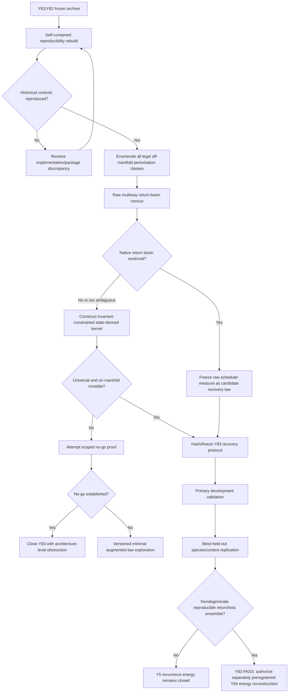
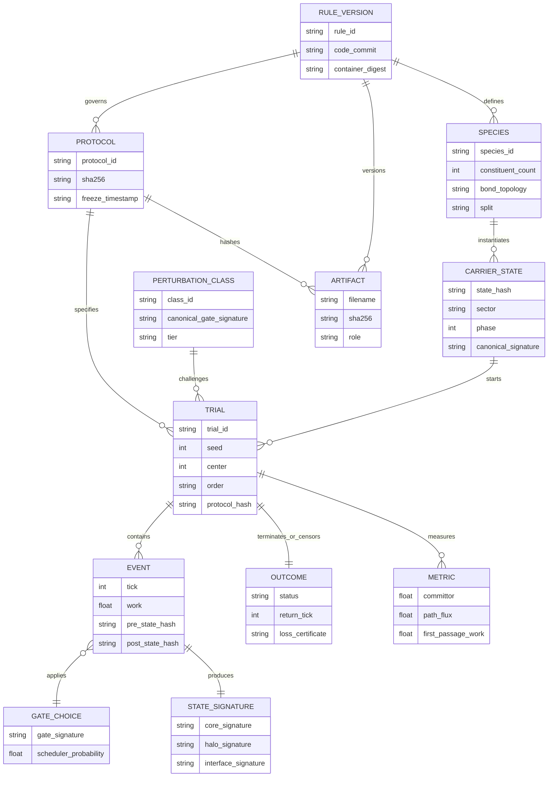
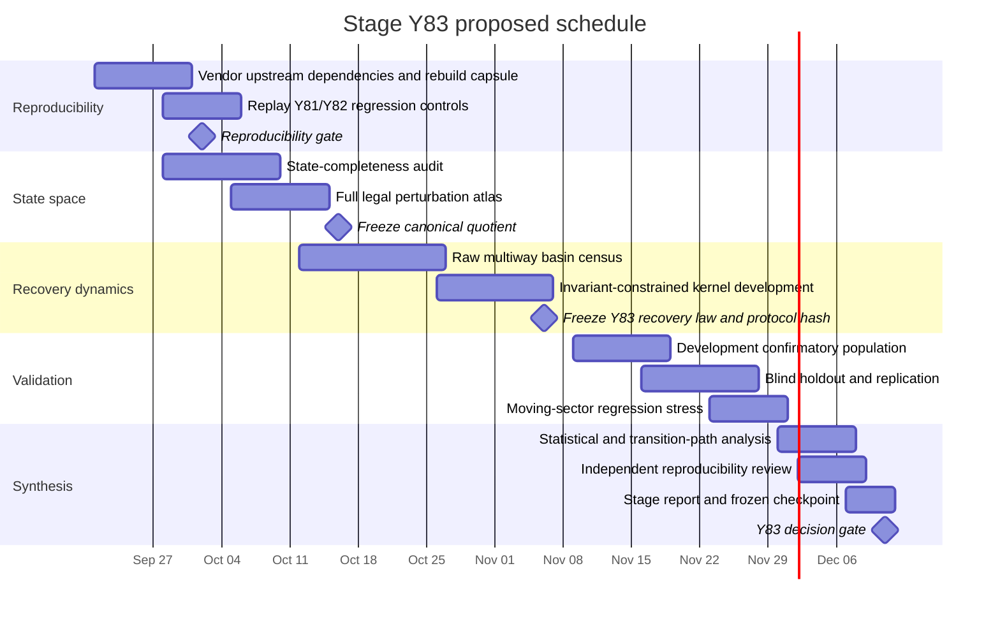

# Stage Y83 Research Program: Autonomous Off-Manifold Regeneration for the CRR/FBCL Gravity–Inertia Mechanism

## Executive summary

The decisive conclusion from the white paper, the Section 10 companion log, and a direct audit of the supplied Y82 archive is that **Stage Y83 should not attempt another rest-energy calculation, another \(M_i\)-to-\(E_0\) fit, or another algebraic definition of “mass.”** The project has reached a more fundamental missing piece: the Flux-Balanced Carrier Law (FBCL) is well specified on its recurrent particle manifold, but it does not yet define autonomous dynamics for a carrier after a legal perturbation takes it off that manifold. Y82 therefore could not reproduce the semantics of the earlier Y5 recurrence-action measurement. This is why Y82 correctly classified \(q_\infty\), \(\mu_{W|\mathrm{return}}\), \(\ell_0\), \(\mathcal R_{\mathrm{act}}\), \(E_0\), and the global \(M_i=\alpha E_0\) test as **undefined or blocked rather than falsified**. fileciteturn0file0 fileciteturn0file1

The immediately preceding positive result remains important. Y81 froze an eight-identity same-law population—DS001, D2R5, D2R6, T3R65, T3R66, T4R656, T4R665, and T4R666—and found the exact extensive direct-contact curvature law

\[
M_i^{\mathrm{ext}}(N)=N\,\frac58\ln 2,
\]

with zero odd component for every tested identity. At equal constituent number \(N\), R5/R6 bond topology is invisible to that observable: the two dimers are exactly degenerate, the two trimers are exactly degenerate, and the three tetramers are exactly degenerate. The companion document therefore records G6 as passed, while explicitly withholding the claim that this quantity is established physical inertial mass. fileciteturn0file0

Y82 then used an amended, legally defined FBCL perturbation panel. Its primary census contained 1,280 trials and its independent replication 640 trials; all 1,920 trials were classified as structural losses at the first synchronized recovery tick, with zero returns. Crucially, that does **not** establish \(q_\infty=0\): the loss was generated by trying to resume an on-manifold scripted lifecycle where its required next operation was no longer defined. Y82's strongest result is consequently a methodological one: **the current FBCL formalism lacks an independently frozen transition law on the off-manifold state space.** fileciteturn0file0

A direct audit of the Y82 ZIP confirms the archive is unusually disciplined. It contains the primary and replication CSVs, challenge summaries, amendments, hashes, the historical Y5 report, and reproduction scripts; the supplied `SHA256SUMS.txt` verifies successfully. It also exposes one concrete reproducibility defect that Y83 should fix before new science is run: `repro/y82_energy.py` imports earlier Y47/Y78/Y79/Y80 code from external absolute paths rather than vendoring or pinning those dependencies inside the Y82 package. Thus the scientific data are integrity-checked, but the archive is not yet a truly self-contained computational capsule.

The core Y83 scientific objective should therefore be:

> **Define and freeze a universal, state-derived, species-independent FBCL transition law that continues to operate after arbitrary admissible carrier-touching legal rewrites, reproduces the existing on-manifold dynamics exactly, and yields objectively defined return, loss, or censoring outcomes without using \(M_i\), \(E_0\), \(\alpha\), species labels, future trajectory information, or desired mass–energy proportionality.**

This objective is closely aligned with the formal logic of multiway rewriting. The Wolfram Physics Project's own technical description represents each possible updating event as a separate branch and merges states according to structural hypergraph equivalence; that is a natural framework for distinguishing “a return path exists” from “the frozen scheduler assigns appreciable probability to a return path.” citeturn4search2turn4search0 For probabilistic analysis after a recovery kernel is frozen, transition-path theory provides the appropriate mathematical language: for discrete-state Markov dynamics it defines committors, reactive fluxes, transition rates, and dominant pathways between designated state sets. citeturn3search0

The recommended Y83 program has six ordered gates:

| Gate | Question | Required result before proceeding |
|---|---|---|
| Reproducibility | Can Y81/Y82 be rebuilt from a self-contained environment? | Historical controls and Y82 rows reproduced exactly or discrepancies fully explained |
| State definition | Is the dynamical state complete off manifold? | All lifecycle information needed for the next transition is explicit and covariant |
| Native-basin test | Does existing FBCL already contain autonomous return paths? | Multiway/Monte Carlo map of return, loss, and unresolved states |
| Recovery-law freeze | Can one universal local law govern off-manifold continuation? | Law frozen without energy/mass inspection and exactly dormant/equivalent on manifold |
| Blind validation | Does it generalize to held-out species, sites, orders, and perturbations? | Nondegenerate, reproducible return/loss ensemble with no covariance violations |
| Energy-readiness decision | Is Y5-style recurrence action operationally measurable again? | Only if all previous gates pass; actual \(E_0\) estimation belongs in the next stage |

The strongest outcome is not necessarily “many recoveries.” A rigorous Y83 result could instead be a scoped no-go theorem showing that no law in a preregistered admissible class can supply autonomous recovery while preserving the frozen FBCL manifold. That would be substantially more informative than introducing increasingly specialized repair code.

## Evidence base and current scientific state

I treated the latest stage chronology as authoritative where older passages of the cumulative white paper retain historically correct but superseded statements. This matters because the draft contains earlier text saying that no inertial measurement had yet been made, while its updated status and companion record now extend through Y82 and include Y81's positive, finite model-internal curvature result. The companion log is therefore the controlling source for the current measurement program, while the main paper remains essential for the substrate, no-go results, PRO history, repair/basin framing, and the larger gravity–inertia motivation. fileciteturn0file0 fileciteturn0file1

The supplied evidence base is:

| Artifact | What it contains | Y83 significance |
|---|---|---|
| Main white paper | Substrate, structural theorems, engineering history, current Y82 status | Defines the scientific claims and what has **not** been established |
| Section 10 companion | Detailed X- and Y-series measurement chronology through Y82 | Primary provenance for Y5, FBCL, G3S/G5/G6, Y81 and Y82 |
| Y82 stage report | Effective scientific interpretation of Y82 | Establishes nonportability rather than infinite energy |
| Y82 protocol plus amendments | Initial plan and corrections made before energy inspection | Defines the anti-selection firewall that Y83 must preserve |
| Y82 raw primary CSV | 1,280 challenge trials | Exact primary nonportability census |
| Y82 raw replication CSV | 640 challenge trials | Independent context/order/tie replication |
| Y82 key/challenge summaries | Compact machine-readable results | Useful regression-test targets |
| Historical Y5 report | Original recurrence-action construction | Defines what “same-law recurrence energy” actually requires |
| Reproduction scripts | State construction, perturbation and stopped rollout | Starting implementation, but dependency packaging must be repaired |

The frozen Y81/Y82 population and split are:

\[
\begin{aligned}
\mathcal P = \{&
\mathrm{DS001},\mathrm{D2R5},\mathrm{D2R6},
\mathrm{T3R65},\mathrm{T3R66},\\
&\mathrm{T4R656},\mathrm{T4R665},\mathrm{T4R666}\}.
\end{aligned}
\]

Development identities are DS001, D2R5, T3R65, and T4R656; the held-out identities are D2R6, T3R66, T4R665, and T4R666. This split should remain untouched throughout Y83 so that the holdout population can still serve as a genuinely independent portability test. fileciteturn0file0

The older Y5 construction is important because it was not simply a curve-fitting recipe. It first measured an asymptotic regeneration phenotype,

\[
(q_\infty,\mu_{W|\mathrm{return}}),
\]

then used composition: independent recoverabilities multiply while successful recovery work adds. Requiring a continuous additive scalar gives a form equivalent to

\[
\mathcal R_{\mathrm{act}}
=
\mu_{W|\mathrm{return}}
-
\ell_0\ln q_\infty,
\]

followed by

\[
E_0=\mathcal R_{\mathrm{act}}\,\omega_{\mathrm{renew}},
\qquad
\omega_{\mathrm{renew}}
=
2\pi\frac{N_{\mathrm{return}}}{N_{\mathrm{particle-hit}}}.
\]

On the old Rule-55584 population, the companion records a carrier-independent \(\ell_0\), reproducible recurrence action, and a stable \(E_0\) characteristic value; but Y82 correctly prohibited transporting the old numerical values into FBCL. fileciteturn0file0

The crucial distinction is that historical Y5 perturbations were legal rewrites followed by an already meaningful autonomous recovery process. Y82's original predeclared document initially described an ablation/deletion challenge, but the amendments corrected this after the historical semantics were recovered. The effective FBCL challenge became an equal-weight phase-1 panel of two legal direct gates per constituent: `compatible_raw` and `competitor_raw`, each fired without the normal marker/Q/interface maintenance. The final stop rule was hashed before \(q_\infty\), \(E_0\), or \(\alpha\) was computed. fileciteturn0file0

The raw data audit gives:

| Y82 population | Trials | Compatible | Competitor | Returns | Losses | First-tick losses |
|---|---:|---:|---:|---:|---:|---:|
| Primary | 1,280 | 640 | 640 | 0 | 1,280 | 1,280 |
| Replication | 640 | 320 | 320 | 0 | 640 | 640 |
| Combined | 1,920 | 960 | 960 | 0 | 1,920 | 1,920 |

The replication was not a trivial rerun: it moved the insertion center from 700 to 500, reversed constituent order, and changed the tie seed. The identical outcome therefore rules out a simple dependence on those implementation choices, but it still does not answer the physical recovery question because both populations resumed the same on-manifold lifecycle after perturbation. fileciteturn0file0

The core architecture already achieved before Y82 is extensive. The project has generated exact recurrent carrier sectors, homogeneous translating vacuum structure, signed velocities, a full \(0,\pm v_1,\pm v_2\) manifold, stationary flux-balanced rest, composite R5/R6 species, and positive extensive direct-contact curvature. Those are substantial internal dynamical results, but they do not yet constitute empirical evidence for real-world gravity or inertia. The Wolfram-model literature provides the formal hypergraph/multiway setting, not independent experimental validation of this particular CRR mechanism. fileciteturn0file0 citeturn4search2

There is nevertheless respectable nonlinear-dynamics precedent for treating localized recurrent structures as dynamical objects rather than persistent pieces of material. MacKay and Aubry's original 1994 result established time-periodic localized “breather” solutions in broad classes of weakly coupled nonlinear oscillator networks, while dissipative-soliton theory provides examples of localized structures maintained by flux with an environment. These are useful structural analogies, not derivations of CRR physics. citeturn8search1turn5search0

## Theoretical gaps and testable Y83 hypotheses

The central gap is best stated as **state-transition completeness**. FBCL currently has an excellent description of a privileged recurrent subset \(\mathcal M\) of state space and a lifecycle that keeps the system on \(\mathcal M\). Y83 must define a transition kernel

\[
K(s\rightarrow s')
\]

for an open neighborhood \(s\in\mathcal N(\mathcal M)\), not just for \(s\in\mathcal M\). Without that object, an experiment that deliberately moves the state into \(\mathcal N(\mathcal M)\setminus\mathcal M\) has no autonomous dynamics to measure.

This is deeper than a programming exception. The Y82 implementation contains explicit lifecycle data structures, delayed-retirement pointers, marker state, interface state, and constituent sequencing. Y83 must decide which of these are genuine dynamical state variables and which are merely external bookkeeping. For a strong physical interpretation, two states that are relationally identical should not evolve differently because a Python object retains different hidden history. The project itself has repeatedly learned this lesson—for example, when raw identity differences later collapsed under stronger order-preserving quotients in Y69–Y71. fileciteturn0file0

I recommend preregistering the following hypotheses.

**State-sufficiency hypothesis.** There exists a finite, translation-covariant description \(S_{\mathrm{FBCL}}\), preferably encoded entirely in the current relational state, from which the legal next-step distribution can be obtained without inaccessible history, absolute vertex labels, species names, or future information. Failure of this hypothesis means FBCL is not yet an autonomous local dynamical law in the strong sense required for a mass-energy interpretation.

**Native-basin hypothesis.** At least some legally perturbed FBCL carrier states already lie in a return basin under the unmodified admissible event dynamics. Formally, for recurrent set \(R\), structural-loss set \(L\), and state \(x\),

\[
q(x)=P_x(\tau_R<\tau_L)
\]

is strictly between zero and one for a nonzero subset of standardized perturbations. Multiway evolution is the correct first diagnostic because it explicitly represents alternative update histories instead of prematurely committing to one scripted continuation. citeturn4search2

**Universal-recovery hypothesis.** If native scheduling alone does not give a usable recovery ensemble, a single state-derived transition policy can resolve ambiguous legal continuations while remaining species-blind and constituent-permutation-covariant. The important word is **single**: D2R5 must not get an R5 “repair routine” simply because its label is D2R5. A topological condition that happens to recognize an R5 motif is acceptable only when the same local rule applies wherever that motif occurs.

**Scheduler-measure hypothesis.** Existence of a return path and realized recovery probability are different quantities. Earlier project stages repeatedly found precisely this existence-versus-measure distinction. Y83 should therefore measure both reachability and scheduler probability. Transition-path theory is well suited to the latter once the dynamics is a well-defined Markov process: it treats the committor, reactive trajectory ensemble, probability current, flux, and dominant transition pathways as separate objects. citeturn3search0

**Topology-sensitivity hypothesis for the later energy stage.** Y81's current \(M_i\) observable depends only on constituent number \(N\), not R5/R6 bond topology. Consequently, if a future same-law \(E_0\) varies substantially among same-\(N\) species, the relation \(M_i=\alpha E_0\) cannot hold for total energy with a single \(\alpha\), even if an across-\(N\) correlation looks excellent. This same-\(N\) comparison is one of the strongest controls in the entire program and must remain sealed from Y83 recovery-law selection. fileciteturn0file0

A further conceptual distinction should be frozen now:

\[
\text{recurrent stability}
\neq
\text{off-manifold regeneration}
\neq
\text{inertial curvature}
\neq
\text{rest energy}
\neq
\text{gravitational coupling}.
\]

Y81 addresses the third item with a model-internal observable. Y83 addresses the second. A successful later \(E_0\) reconstruction would address the fourth only after an independent \(M_i\)-comparison succeeds. The original gravity/equivalence question remains farther downstream.

## Experimental and simulation program

No physical bench apparatus is scientifically warranted at Y83. The required apparatus is computational: the exact FBCL simulator, canonical hypergraph/state-signature machinery, deterministic and stochastic schedulers, multiway state enumeration, statistical analysis, immutable storage, and sufficient CPU/RAM to explore branching state spaces. A physical gravity experiment would be premature because the model currently has no calibrated map from its internal transport/curvature units to laboratory observables.

The experiments should be executed in the following order.

| Experiment | Objective and hypothesis | Apparatus / software | Variables and controls | Sample size / search budget | Expected outcomes | Success criterion |
|---|---|---|---|---|---|---|
| **Reproducibility reconstruction** | Prove Y81/Y82 can be regenerated before extending them | Pinned Python environment; vendored Y46/Y47/Y77–Y80 dependencies; historical CSVs and hashes | Control = archived Y82 outputs and Y81 invariants | Reproduce all 1,920 Y82 trials; replay Y81 population controls and 280-period rest audit | Exact match, or a small documented packaging-only discrepancy | Row-level equality for deterministic outputs; all manifest hashes valid; zero unexplained scientific differences |
| **Full perturbation atlas** | Determine the actual off-manifold neighborhood rather than relying only on Y82 phase 1 | Exact legal-gate enumerator; canonical state reducer | Species, 8 rest phases, constituent, gate class, source role, external/internal recruit, bond involvement | Exhaustive enumeration, not sampling | Finite equivalence classes of perturbations | Every legal carrier-touching gate categorized before recovery outcome is used |
| **Raw multiway basin census** | Test whether unmodified dynamics already contains return paths | Multiway BFS/DFS, canonical hashing, branch Monte Carlo fallback | Perturbation class, phase, species, site | Exact search to depth 32 or 250k canonical states/class; if open, 512 scheduler trajectories/class to horizon 256 | Some classes may return; others may prove absorbing | Identify at least one rigorous return path or establish a scoped no-return closure/no-go for tested class |
| **Invariant-constrained recovery kernel** | Freeze a universal autonomous continuation law if raw dynamics is ambiguous | State decoder; invariant checker; existing FBCL gate generator; no energy code loaded | Current structural state only; no species label or \(M_i/E_0\) | Development identities only; 128 trajectories per canonical class during design | Nondegenerate recoveries without on-manifold change | One frozen kernel applies to all development species and exactly reproduces on-manifold transitions |
| **Blind population validation** | Test transfer without refitting | Frozen kernel, sealed holdout identities, independent contexts | Species, topology, class, site, order, tie | Tier-A minimum 300 trials/species/context; two independent contexts = 4,800 trials total | Return/loss/censor mixture with reproducible rates | No law changes; objective outcomes; both primary and replication contain statistically usable return/loss events |
| **Moving-sector stress test** | Ensure “repair” does not secretly destroy established kinematics | Frozen \(v=\pm v_1,\pm v_2\) trajectories | Velocity/sign, species, off-manifold perturbation | 100 trials/species/moving sector = 3,200 | On-manifold states unchanged; off-manifold behavior remains covariant | Zero regressions in frozen moving controls and no sign-specific hard-coding |
| **No-go / minimal-extension branch** | Obtain a theorem or clearly versioned new law if autonomous recovery is impossible | Exhaustive bounded synthesis, SAT/search if useful | Admissible local operation class | Predeclared finite grammar shell | Either proof of impossibility or minimal dormant extension | Never silently fold a new law back into “original FBCL”; version it separately |

The first scientific experiment after reproducibility should be the perturbation atlas because Y82 tested a deliberately narrow, clean phase-1 panel. That panel must be retained as **Tier A** for direct comparability, but Y83 should discover the complete set of legal carrier-touching perturbation equivalence classes across all eight stationary phases before outcomes are inspected. This prevents a future recovery result from depending on one favorable phase.

The atlas should use at least three perturbation tiers:

| Tier | Definition | Role |
|---|---|---|
| A | Exact Y82 `compatible_raw` / `competitor_raw` phase-1 panel | Historical bridge and confirmatory core |
| B | Every legal carrier-touching gate over all eight stationary phases, reduced by a frozen canonical quotient | Main Y83 off-manifold domain |
| C | Equivalent legal perturbations applied to \(\pm v_1,\pm v_2\) sectors | Stress/generalization, not recovery-law discovery |

The raw multiway census is particularly important because it makes a distinction the stopped Y82 rollout could not. Official Wolfram-model methodology represents a separate path for every possible update event and identifies structurally equivalent hypergraphs independently of node labels. citeturn4search2 If no branch from a challenged state returns to a recurrent state under a clearly specified admissible event set, a specialized scheduler cannot create a return without changing that event set. Conversely, if return paths exist but occupy tiny scheduler measure, the problem is one of transition probability rather than structural impossibility.

The proposed **invariant-constrained recovery kernel** should not be a learned mapping from “damaged state” to “action that eventually returns.” That would be dangerously close to training on the answer. Instead:

1. Recognize current constituent-core motifs by structural equivalence.
2. Decode any sign/marker/interface information that is actually present in the state.
3. Enumerate presently legal FBCL particle-coupled actions.
4. Reject actions only by invariants already required by the frozen architecture—for example, legal marker/Q lifecycle constraints, bounded live-interface requirements, causal retirement rules, and constituent consistency.
5. If one action remains, take it.
6. If several structurally equivalent actions remain, use a preregistered, label-invariant probability measure, preferably uniform unless an earlier frozen scheduler measure already applies.
7. Never consult distance-to-return, eventual outcome, \(M_i\), \(E_0\), species ID, or a future simulation during action selection.

This gives Y83 a clean falsifiable question: **are the invariants that define FBCL on manifold sufficient to extend its dynamics off manifold?**

On-manifold invisibility is a hard constraint. For every frozen phase of every \(v=0,\pm v_1,\pm v_2\) identity, the Y83 kernel must produce the same next transition distribution and the same marker/Q/retirement operations as the prior frozen implementation. Any new rule that “improves recovery” but changes an established sector is not a recovery law; it is a different theory.

The return criterion can preserve Y82's strongest feature: exact phase-aware recurrence of relative constituent coordinates, signs/phases, live-Q counts, connected interaction graph, local carrier invariants, and the complete order-preserving carrier-plus-halo signature. fileciteturn0file0 The **loss criterion should change**. A state must not be called physically lost merely because a previously scripted Python operation is unavailable. A defensible Y83 classification is:

\[
\text{Outcome}=
\begin{cases}
\mathrm{return}, & \text{recognized recurrent state reached},\\
\mathrm{loss}, & \text{absorbing structural-loss class proven/reached},\\
\mathrm{censored}, & \text{neither established before search horizon}.
\end{cases}
\]

An absorbing loss can be certified, for example, when no admissible carrier-preserving continuation exists in a closed enumerated successor set, or when a proven structural invariant forbids return. Otherwise the state should remain censored.

The proposed workflow is:

The main experiment risks are methodological rather than physical:

| Risk | Probability | Impact | Mitigation |
|---|---|---|---|
| Hidden lifecycle memory makes “state-only” dynamics impossible | Medium–high | Critical | Explicit state-completeness audit; encode or eliminate hidden registers |
| Multiway branch explosion | High | High | Canonical state hashing; symmetry quotient; strict exact-search budget plus preregistered Monte Carlo fallback |
| Outcome-driven rule tuning | Medium | Critical | Development/holdout firewall; energy modules inaccessible during recovery-law design; protocol hashes |
| Species-specific repair creeping into code | Medium | Critical | Policy receives structural state only; unit test that species labels are unavailable |
| False “loss” caused by controller exception | High if unchanged from Y82 | Critical | Structural absorbing criterion; otherwise censor |
| Recovery kernel alters established sectors | Medium | Critical | Exhaustive on-manifold regression suite across five sectors and all species |
| Too few return or loss events for later \(q_\infty\) estimation | Medium | Moderate | Predeclared sequential extension, without changing law |
| Exact-search result depends on vertex IDs | Medium | High | Order-preserving/canonical structural quotient and permutation tests |

A priority assessment using feasibility, impact, cost, time and physical/operational safety gives:

| Work item | Feasibility | Scientific impact | Cost efficiency | Time efficiency | Safety | Priority |
|---|---:|---:|---:|---:|---:|---|
| Reproducibility rebuild | 5/5 | 5/5 | 5/5 | 5/5 | 5/5 | **Immediate** |
| Perturbation atlas | 5 | 4 | 5 | 4 | 5 | **Immediate** |
| Raw multiway basin census | 4 | 5 | 3 | 3 | 5 | **Very high** |
| State-completeness audit | 4 | 5 | 5 | 4 | 5 | **Very high** |
| Invariant-constrained kernel | 3 | 5 | 3 | 3 | 5 | **High** |
| Blind validation | 4 | 5 | 3 | 3 | 5 | **Mandatory after freeze** |
| Scoped no-go proof | 3 | 5 | 4 | 2 | 5 | **High if kernel fails** |
| New augmented grammar | 2 | 3–4 | 2 | 2 | 5 | **Fallback only** |
| New \(E_0\)/\(\alpha\) calculation inside Y83 | 5 technically | 1 scientifically | 1 | 1 | 5 | **Do not run** |

## Analysis, statistics, decision rules, and visualization

Y83 should distinguish **exact structural tests** from **ensemble-statistical tests**. When a property is algebraic—on-manifold equivalence, translation covariance, constituent-permutation covariance, equality of canonical state signatures—do not turn it into a p-value. Report the number of violations directly. Statistical inference is appropriate for scheduler-mediated quantities such as recovery probability and first-passage work.

For every challenged state \(x\), the most informative primary quantity is the recovery committor

\[
q(x)=P_x(\tau_R<\tau_L),
\]

where \(R\) is the recurrent-return set and \(L\) a rigorously defined structural-loss set. This is directly analogous to the committor used in transition-path theory for Markov jump processes. The same framework can provide reactive flux and dominant recovery pathways, which is considerably more informative than a single recovery percentage. citeturn3search0

The recommended analysis stack is:

| Question | Primary method | Secondary / robustness method | Recommended visualization |
|---|---|---|---|
| Does any return path exist? | Exact multiway reachability | Bounded model checking / exhaustive branch closure | Directed state graph; shortest-return path diagram |
| What is return probability? | Binomial proportion with exact/Wilson CI | Stratified bootstrap over sites/seeds | Forest plot by species/class |
| How long does recovery take? | First-passage distribution | Discrete hazard | ECDF and survival-style curve |
| Return versus structural loss | Competing-risk cumulative incidence | Cause-specific discrete hazards | Stacked cumulative-incidence plot |
| Which states are “committed” to return? | Committor \(q(x)\) | State-cluster smoothing only descriptively | State-space heat map |
| Which paths carry scheduler measure? | Reactive flux / path probability | Top-\(k\) path decomposition | Sankey/alluvial transition flow |
| Does behavior replicate? | Primary–replication effect differences | Cluster/bootstrap interval | Paired species plot |
| Does topology matter? | Same-\(N\) contrasts | Permutation test within \(N\) | Same-\(N\) dumbbell plot |
| Is kernel covariant? | Exact transformed-state equality | Property-based randomized tests | Failure matrix |
| Are there many exploratory class comparisons? | Effect sizes + Holm correction | False-discovery-rate diagnostic | Phase × perturbation heat map |

The earlier Y4/Y5 cure-model machinery should **not** be the primary Y83 model. It becomes appropriate only after an autonomous recovery ensemble has been established. Y83's job is to determine whether the stochastic process to which that model would be fitted actually exists. fileciteturn0file0

For confirmatory Tier-A validation, I recommend **300 trials per species per context**, split equally between the two Y82 legal challenge classes. With zero returns in a 300-trial cell, the one-sided 95% binomial upper bound is approximately

\[
1-0.05^{1/300}\approx 0.00994,
\]

so a continued all-zero result would constrain recovery probability below about 1% at that confidence level without needing a much larger initial sample. Two contexts give \(8\times 300\times2=4{,}800\) confirmatory trials. The second context should jointly change location, constituent order and tie seed, as Y82 already did.

For later recurrence-energy readiness, a simple “at least one recovery” standard is too weak. I recommend a predeclared sequential rule: begin with 300 trials per species/context and extend, without changing any model definition, to at most 1,000 per species if a species has fewer than 30 successful returns or fewer than 30 genuine structural-loss events after pooling the two contexts. If one outcome remains too rare even at the cap, Y83 may still establish valid autonomous dynamics, but that species is not yet statistically suitable for a stable Y5-style \(q_\infty\)/conditional-work measurement.

The development/holdout split must be treated as a real firewall. All choices concerning the recovery kernel—features, state decoder, branch weighting, invariant hierarchy, tie rules, cleanup semantics—must be made using the four development identities only. The four Y81-held-out identities should not even generate outcome summaries until the recovery law and code hash are frozen.

The most important success criteria are therefore structural first and statistical second:

1. **State completeness:** the next-step law has no undeclared hidden history.
2. **Species blindness:** the policy does not receive an identity label or constituent count as a special case.
3. **Covariance:** translation, relabeling and constituent-order transformations give transformed-equivalent dynamics.
4. **Exact on-manifold preservation:** zero regression on all frozen \(0,\pm v_1,\pm v_2\) trajectories.
5. **Objective outcomes:** return/loss/censoring do not depend on controller exceptions.
6. **Independent transfer:** held-out species are run without refitting.
7. **Nondegenerate recovery:** both genuine returns and genuine losses occur under the frozen law in a sufficiently large ensemble for subsequent inference.
8. **Replication:** the qualitative result survives location/order/tie changes.

The Y83 data architecture should itself be made explicit:

This schema makes one subtle but important practice enforceable: every reported result should identify not just a species and seed but the **rule version, protocol hash, starting canonical state, perturbation class, scheduler law, and code/container digest**.

## Delivery plan, timeline, personnel, and budget

A 12-week Y83 is realistic if it is treated as a computational-mechanism stage rather than as an open-ended search. The schedule below begins on Monday, September 21, 2026, immediately after the current September 19 checkpoint.

The corresponding milestones and deliverables are:

| Milestone | Deliverable | Acceptance test |
|---|---|---|
| Reproduction gate | `Y83_REPRO_CAPSULE` | Historical Y81/Y82 outputs reproduced; all dependency versions local/pinned |
| State-definition freeze | Formal FBCL state specification | No undeclared lifecycle memory required for transition evaluation |
| Perturbation freeze | Canonical challenge atlas | All legal carrier-touching classes enumerated/canonicalized before scoring |
| Native-basin result | Multiway recovery report | Return reachability and absorbing/censored classes separated |
| Law freeze | `Y83_RECOVERY_PROTOCOL.md` + SHA-256 | No \(M_i/E_0/\alpha\) inputs; exact on-manifold regression passes |
| Primary validation | Development dataset | Predeclared trial counts, no protocol change |
| Blind replication | Holdout dataset | Holdout opened only after law hash |
| Final stage package | Report, raw records, analysis, environment, manifests | Independent clean-machine reproduction |
| Decision checkpoint | PASS / BLOCKED / NO-GO | Explicit authorization or prohibition for Y84 recurrence energy |

The minimum useful team is small but cross-functional:

| Role | Core responsibility | Essential skills |
|---|---|---|
| Scientific lead / theoretical physicist | Guard definitions, scope and physical interpretation | Discrete dynamics, relational models, nonlinear systems, strong anti-overclaim discipline |
| Computational scientist | Multiway enumeration, scheduler simulations, state-space analysis | Python, stochastic simulation, graph/hypergraph algorithms, numerical profiling |
| Research software engineer | Self-contained simulator and reproducibility infrastructure | Packaging, CI, containers, deterministic RNG, testing, artifact hashing |
| Statistician / applied probabilist | Committor/first-passage/competing-risk analysis | Markov processes, survival/competing-risk methods, resampling, preregistration |
| Independent reproducibility reviewer | Blind rerun and protocol-leakage audit | Code review, computational reproducibility, no stake in discovery result |

One person can cover multiple roles in a lean project, but the person who authors the recovery kernel should preferably not be the only person who validates the held-out run.

Because facilities and budget ceiling were unspecified, three planning scenarios are more useful than one false-precision quote. These are **internal budgeting assumptions, not market-rate estimates**.

| Scenario | Staffing | Compute | Calendar | Estimated incremental budget |
|---|---|---|---:|---:|
| Lean | One full-time computational/theory researcher + limited independent review | Existing workstation; modest rented overflow | 12–16 weeks | **\$60k–\$85k** |
| Standard | Scientific lead + computational scientist + 0.6 RSE + part-time statistician/reviewer | Dedicated multicore workstation/server or equivalent compute pool | 12 weeks | **about \$145k–\$150k** |
| Full independent validation | 3–4 person technical team + separate reproducer | Multiple large-memory nodes / larger cloud-HPC allowance | 10–12 weeks | **\$250k–\$300k** |

A transparent standard-case budget, using assumed loaded planning rates solely to make the estimate reproducible, is:

| Item | Assumption | Estimate |
|---|---:|---:|
| Scientific lead / theory | 160 h × \$150/h | \$24,000 |
| Computational scientist | 400 h × \$125/h | \$50,000 |
| Research software engineer | 240 h × \$110/h | \$26,400 |
| Statistician / applied probabilist | 80 h × \$140/h | \$11,200 |
| Independent reproducibility reviewer | 40 h × \$150/h | \$6,000 |
| Compute / large-memory overflow | Fixed planning allowance | \$8,000 |
| Fast storage + replicated backup | Fixed allowance | \$1,500 |
| Software/miscellaneous infrastructure | Fixed allowance | \$1,000 |
| Subtotal |  | \$128,100 |
| Contingency | 15% | \$19,215 |
| **Planning total** |  | **\$147,315** |

The largest uncertainty is compute consumption from multiway branching. That uncertainty should be controlled by algorithmic stopping rules rather than an open-ended cloud bill: canonicalize states aggressively; measure branching growth during the first depth levels; cap exact search by both depth and number of unique canonical states; then fall back to a frozen Monte Carlo design rather than silently increasing the search until a desirable path appears.

A practical computational apparatus target is a modern multicore machine with ample RAM and fast local storage plus access to embarrassingly parallel batch capacity. GPU hardware is not an obvious priority: the current workload is dominated by irregular graph rewriting, state canonicalization, branch management and many independent trajectories rather than dense matrix arithmetic.

Physical safety risk is negligible at this stage because no laboratory force, radiation, high voltage, vacuum system or mechanical apparatus is required. The important safety analogues are scientific integrity and operational safeguards: immutable raw data, read-only held-out directories, checksummed artifacts, bounded compute jobs, backups, and explicit separation between discovery and validation code.

## Reproducibility, publication strategy, and intellectual property

Y83 should raise the project's reproducibility standard from “the output files have hashes” to **complete executable provenance**. The Y82 ZIP already does several things well: protocol amendments are preserved rather than overwritten, raw outputs are separate from summaries, deterministic seeds are recorded, and artifact hashes verify. The main gap is that the main reproduction module imports scientific dependencies from external absolute directories. A future independent reader should not need the original research machine's `/mnt/data/y80_run` or `/mnt/data/y82_work/...` hierarchy to execute the stage.

The Y83 repository should therefore contain, at minimum:

- a single frozen source tree or explicitly versioned submodules for every Y46–Y82 dependency needed by Y83;
- a lockfile for Python and library versions;
- a container recipe and resulting image digest;
- one command that rebuilds the historical regression controls and one command that runs Y83;
- immutable raw outputs, with derived tables regenerated rather than manually edited;
- a manifest containing SHA-256 for protocols, source archives, raw data, analysis tables and final figures;
- deterministic RNG streams assigned by semantic role rather than global execution order;
- tests for translation covariance, relabeling, constituent permutation, on-manifold equality, and canonical-state equivalence;
- a machine-readable experiment registry recording `protocol_hash`, `code_commit`, `container_digest`, `species`, `state_hash`, `perturbation_class`, `seed`, `site`, `outcome`, and analysis version;
- a changelog that distinguishes packaging fixes from scientific changes;
- explicit “sealed” directories or access controls for held-out results until the recovery law is frozen.

Protocol amendments should continue the Y82 practice: never silently edit the frozen protocol. Create `AMENDMENT_A`, hash it, state whether it occurred before or after any relevant outcome inspection, and explain whether it strengthens, weakens or merely repairs the test.

For publication, the most defensible first manuscript is **not** “Emergent gravity derived from FBCL.” A successful Y83 could support a paper framed around autonomous regeneration, recurrent localized states, and transition basins in relational hypergraph rewriting. A negative theorem would also be publishable if it identifies a genuine obstruction rather than simply reporting failed parameter searches. *Physical Review E* explicitly covers statistical physics, nonlinear dynamics, networks/complex systems and computational physics, making it a plausible venue for a strongly computational Y81–Y83 result. citeturn6search0 *Nonlinearity* is especially plausible if Y83 produces a mathematically sharp state-space or no-go theorem, because its scope explicitly includes nonlinear mathematical physics, theoretical work, proofs and significant numerical experiments. citeturn6search1

A sensible publication sequence is:

| Manuscript | Trigger | Main claim |
|---|---|---|
| Methods/dynamics paper | Y83 autonomous law or rigorous no-go | Off-manifold transition dynamics and recovery basins |
| Inertia/rest-energy paper | Later same-law \(E_0\) and blind global-\(\alpha\) test | Whether model-internal inertial curvature covaries with independently measured recurrence energy |
| Gravity/equivalence paper | Only after a separately defined backreaction/gravitational observable | Whether gravitational response and inertial response share one proportional quantity |

The distinction matters scientifically. Localized recurrent structures and dissipative-soliton-like control-volume closure have legitimate precedent in nonlinear dynamics, but the analogy does not make FBCL a physical theory of matter by itself. citeturn8search1turn5search0 Likewise, official Wolfram-model multiway formalism supports the computational representation being explored here, but it should be cited as framework provenance rather than as experimental evidence for CRR. citeturn4search2

On intellectual property, the most promising potential IP is likely to lie in **specific computational technology**, not in a purported “law of gravity” or mathematical relationship. Current USPTO guidance treats abstract ideas, mathematical formulas, laws of nature and natural phenomena as judicial exceptions, although a claim may be eligible when the exception is integrated into a practical application; software is not categorically excluded. citeturn3search2turn3search3 The USPTO's 2025 MPEP update also emphasizes claimed improvements to computer functionality or another technological field while distinguishing §101 eligibility from the separate novelty, nonobviousness and disclosure requirements of §§102, 103 and 112. citeturn3search5

Accordingly, potential invention disclosures worth evaluating with patent counsel would be narrowly technical items such as a novel canonical state-reduction algorithm for massive multiway hypergraph searches, a new invariant-constrained controller-synthesis method for rewrite systems, or a materially improved computational mechanism for transition-basin estimation. The equations \(M_i=N(5/8)\ln2\), \(\mathcal R=\mu-\ell\ln q\), or a hypothetical discovered physical law should not be assumed patentable merely because they are novel to the project. This is a legal-strategy area where claim details and jurisdiction matter; patent counsel should review any filing before public disclosure if preserving patent options is important. citeturn3search3turn3search5

The recommended Y83 IP practice is therefore to maintain dated invention records and commit hashes, separate fundamental scientific discoveries from implementation inventions, make an IP/publication decision before releasing the frozen source capsule, and then favor maximum reproducibility once that decision has been made.

**Sources used for this assessment**

The project-specific conclusions above are grounded primarily in the uploaded **`CRR_White_Paper_Draft (46).md`** fileciteturn0file1 and **`CRR_Companion_Section10_Mass_Inertia_Program (47).md`**. fileciteturn0file0 I also directly unpacked and audited **`CRR_Stage_Y82_FBCL_Recurrence_Energy_Nonportability(1).zip`**, including its stage report, checkpoint, effective protocol and amendments, `Y82_KEY_RESULTS.csv`, `Y82_CHALLENGE_SUMMARY.csv`, the 1,920 primary/replication raw records, historical Y5 report, SHA-256 manifests, and reproduction code.

For external theoretical/methodological context, the principal sources are the Wolfram Physics Project's official technical description of multiway hypergraph evolution, which treats every possible updating event as a branch and merges structurally isomorphic hypergraphs; citeturn4search2turn4search0 Metzner, Schütte and Vanden-Eijnden's original transition-path-theory treatment for Markov jump processes; citeturn3search0 MacKay and Aubry's 1994 *Nonlinearity* paper on localized time-periodic breathers; citeturn8search1 and Grelu and Akhmediev's review of dissipative solitons as localized structures maintained through environmental exchange. citeturn5search0 Current publication-scope information comes from the official APS description of *Physical Review E* and IOP/LMS description of *Nonlinearity*. citeturn6search0turn6search1 Current U.S. patent-eligibility considerations are based on USPTO MPEP §§2104/2106 and the December 2025 USPTO eligibility update. citeturn3search2turn3search3turn3search5